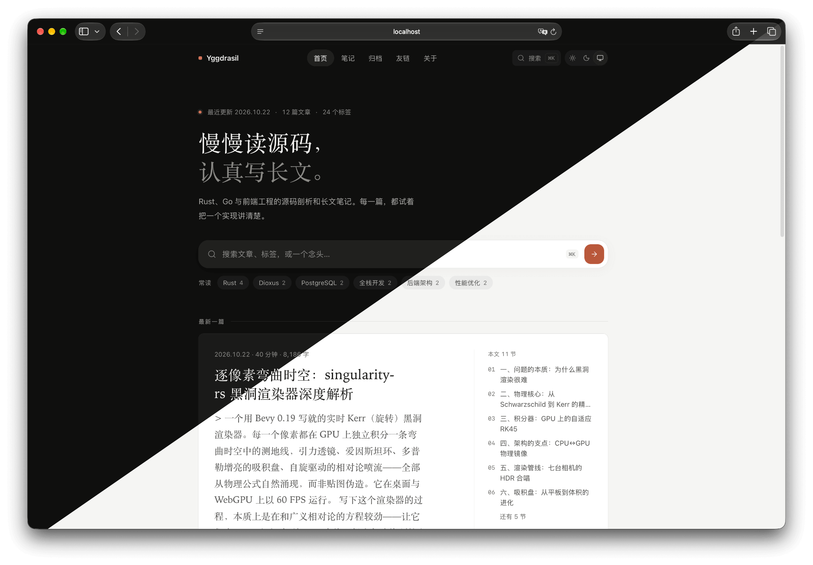

# Yggdrasil


基于 Leptos 0.8 的全栈博客与内容管理系统。一套 Rust 代码，同时编译为浏览器端 WASM（路由级分包）与原生 Axum 服务端。

在线实例：<https://rua.plus>



## 特性

- **写作**：Tiptap 富文本编辑器，支持脚注、任务列表、数学公式与 Mermaid；服务端以 pulldown-cmark、syntect、KaTeX 渲染。
- **笔记与知识库**：随记、主题笔记与公开版 / 知识库版本，详见 [笔记文档](docs/notes.md)。
- **MCP**：内置 MCP 服务器（`POST /mcp`），AI 客户端可检索文章并按作用域管理内容，详见 [MCP 文档](docs/mcp.md)。
- **代码沙箱**：文章内 `runnable` 代码块与 `/admin/runner` 在隔离 Docker 容器中运行 Python / Node / Go / Rust / Bun，SSE 实时回显。
- **运维**：数据库状态、服务器监控、SQL 控制台、数据导出与 `pg_dump` 备份恢复。
- **性能与安全**：增量 SSR 与 moka 多级缓存；Argon2、CSRF 防护、按 IP 限流。
- **外观**：陶土橙暖调明暗双主题，系统字体与 Lucide 图标，响应式布局。

## 技术栈

Leptos 0.8 · cargo-leptos · Axum · PostgreSQL · Tailwind CSS v4 · Bun workspace（Tiptap / CodeMirror / xterm.js / Mermaid）· bollard

## 快速开始

准备 Rust、cargo-leptos 0.3.11（`cargo install cargo-leptos --version 0.3.11 --locked`）、Tailwind CSS v4 standalone CLI 与 Bun，复制 `.env.example` 为 `.env`，然后：

```sh
make dev     # 增量构建前端资源并启动开发服务
make test    # Rust 与前端测试
make lint    # Biome / TypeScript / Clippy / rustfmt
make build   # 发布构建
```

直接运行 `make` 可列出全部目标；缺少本地工具时可用 `make docker-dev`。

## 生产部署

必须前置反向代理（nginx / Caddy）终结 TLS，并配置：

- `APP_BASE_URL`：CSRF 可信来源
- `COOKIE_SECURE=true`
- `TRUSTED_PROXY_COUNT`：X-Forwarded-For 中真实客户端 IP 右侧的段数，不等于代理层数。直连填 0；单层反代用 `$remote_addr` 覆盖 XFF 并设置 `X-Real-IP` 时填 1；CDN + 源站反代（都追加 XFF）填 1 而非 2。设大会信任伪造 IP 绕过限流；源站还须只接受上游代理回源，否则直连源站同样可伪造

容器监听 `127.0.0.1:3000`，探针为 `/healthz`（存活）与 `/readyz`（就绪）。

## 目录

```
src/         Rust 源码（api / mcp / db / pages / components）
libs/        前端 JS 库（Bun workspace）
migrations/  SQL 迁移，启动时自动运行
docker/      Dockerfile 与沙箱镜像
docs/        专题文档
```

## 文档

- [更新日志](CHANGELOG.md)
- [贡献者约定](AGENTS.md)
