这是一份用来检验 Yggdrasil 渲染管线的综合性文章：每一节对应站点的一项写作能力，包括排版、提示块、表格、多语言代码高亮、可在浏览器里运行的代码、KaTeX 与化学公式、二十余种 Mermaid 图表、脚注、图片灯箱和折叠内容。页面里任何一处显示异常，都说明对应环节出了回归。

## 一、标题层级

页面标题已经占用 H1，正文从 H2 开始，目录和锚点由系统自动生成。下面依次展开 H3 到 H6。

### 三级标题 H3

#### 四级标题 H4

##### 五级标题 H5

###### 六级标题 H6

## 二、行内样式

**粗体**、*斜体*、***粗斜体***、~~删除线~~，也可以**嵌套 *斜体* 使用**。行内代码：运行 `make dev` 启动开发服务器，用 `cargo build --release` 构建发布版。

部分行内 HTML 会保留下来：快捷键 <kbd>Ctrl</kbd> + <kbd>K</kbd> 打开搜索，<mark>高亮标记</mark>用来强调，<u>下划线</u>、<ins>新增</ins>、<del>删除</del>，化学式 H<sub>2</sub>O 与 CO<sub>2</sub>，面积单位 m<sup>2</sup>，以及 <ruby>漢<rt>han</rt>字<rt>ji</rt></ruby> 这样的注音。

行尾加两个空格可以强制换行，  
这一行就是换行之后的内容。

## 三、提示块与引用

GitHub 风格的五种提示块都有各自的配色与图标：

> [!NOTE]
> 补充说明：读者即使略读，也不会错过这里的信息。

> [!TIP]
> 小技巧：`make dev-assets` 可以在不重启服务器的情况下刷新前端资源。

> [!IMPORTANT]
> 关键信息：`server` 与 `hydrate` 两个 feature 互斥，不要同时启用。

> [!WARNING]
> 风险提示：运行器镜像升级前，先确认旧容器已经退出。

> [!CAUTION]
> 危险操作：`DROP TABLE` 之后数据无法恢复。

普通引用块可以包含强调、链接与行内代码，也可以嵌套：

> 这是一级引用，里面有 **粗体**、`行内代码` 和 [链接](https://example.com)。
>
> > 这是嵌套的二级引用。
>
> 引用里同样可以放列表和代码：
>
> 1. 第一项
> 2. 第二项
>
> ```rust
> let answer = 42;
> ```

## 四、列表

### 无序与有序列表

- 第一项
- 第二项
  - 嵌套项 2.1
  - 嵌套项 2.2
    - 更深一层 2.2.1
- 第三项

1. 克隆仓库
2. 安装依赖
   1. 安装 Rust 工具链
   2. 安装 Bun 与 cargo-leptos
3. 启动服务

### 任务列表

- [x] 配置 Rust 工具链
- [x] 准备 PostgreSQL
- [x] 运行 `make dev`
- [ ] 编写单元测试
- [ ] 部署到生产环境

## 五、表格

### 对齐方式

| 左对齐 | 居中对齐 | 右对齐 |
| :--- | :---: | ---: |
| Left | Center | Right |
| 第二行 | 第二行 | 123.45 |
| 第三行 | 第三行 | 6.7 |

### 单元格里的行内元素

| 功能 | 渲染位置 | 示例 |
| --- | --- | --- |
| 代码高亮 | 服务端（syntect） | `fn main() {}` |
| 数学公式 | 服务端（KaTeX） | $E = mc^2$ |
| 脚注 | 服务端 | 见此处[^table-note] |
| Mermaid | 浏览器，进入视口时懒加载 | **二十余种图表** |
| 可运行代码 | 服务端 Docker 沙箱 | [运行器](#shi-yi-ke-yun-xing-dai-ma-kuai) |

## 六、代码高亮

服务端用 syntect 着色，页面不需要额外的高亮脚本，每个代码块右上角带复制按钮。没有语言标记的围栏按纯文本显示。

### 系统与后端语言

```rust
use std::collections::HashMap;

#[derive(Debug, Clone)]
struct Post {
    id: i64,
    title: String,
}

fn index(posts: &[Post]) -> HashMap<i64, &Post> {
    posts.iter().map(|p| (p.id, p)).collect()
}
```

```go
package main

import "fmt"

type Stack[T any] struct{ items []T }

func (s *Stack[T]) Push(v T) { s.items = append(s.items, v) }

func main() {
	s := &Stack[string]{}
	s.Push("yggdrasil")
	fmt.Println(len(s.items))
}
```

```zig
const std = @import("std");

pub fn main() void {
    std.debug.print("Hello, {s}!\n", .{"Zig"});
}
```

```python
from dataclasses import dataclass


@dataclass
class Point:
    x: float
    y: float


def centroid(points: list[Point]) -> Point:
    n = len(points)
    return Point(sum(p.x for p in points) / n, sum(p.y for p in points) / n)
```

### 移动端与前端语言

```kotlin
data class User(val name: String, val age: Int)

fun main() {
    listOf(User("Alice", 30), User("Bob", 25))
        .filter { it.age >= 28 }
        .forEach { println("${it.name}: ${it.age}") }
}
```

```swift
struct Greeting {
    let message: String

    func say(to name: String) -> String {
        "\(message), \(name)!"
    }
}

print(Greeting(message: "Hello").say(to: "world"))
```

```typescript
interface Todo {
  id: number;
  title: string;
  done: boolean;
}

const toggle = (todo: Todo): Todo => ({ ...todo, done: !todo.done });
```

```tsx
import { useState } from "react";

export function Counter() {
  const [count, setCount] = useState(0);
  return <button onClick={() => setCount((c) => c + 1)}>clicked {count} times</button>;
}
```

```vue
<template>
  <button class="hello" @click="count++">{{ message }} {{ count }}</button>
</template>

<script setup lang="ts">
import { ref } from "vue";

const message = ref<string>("clicked");
const count = ref(0);
</script>

<style scoped>
.hello {
  color: #42b883;
}
</style>
```

```html
<!doctype html>
<html lang="zh-CN">
  <head>
    <meta charset="utf-8" />
    <title>Hello</title>
  </head>
  <body>
    <p class="greeting">你好，世界</p>
  </body>
</html>
```

```css
.card {
  display: grid;
  gap: 0.75rem;
  border: 1px solid color-mix(in oklab, currentColor 20%, transparent);
  border-radius: 12px;
}

@media (prefers-color-scheme: dark) {
  .card { background: #111; }
}
```

### 配置、数据与脚本

```toml
[package]
name = "yggdrasil"
edition = "2021"

[features]
default = ["server"]
hydrate = []
```

```yaml
services:
  app:
    image: yggdrasil:latest
    environment:
      DATABASE_URL: postgres://user:pass@db:5432/yggdrasil
    ports:
      - "8080:8080"
```

```json
{
  "name": "yggdrasil",
  "features": ["ssr", "markdown", "mcp"],
  "private": true
}
```

```sql
SELECT t.name, COUNT(*) AS posts
FROM tags t
JOIN post_tags pt ON pt.tag_id = t.id
GROUP BY t.name
ORDER BY posts DESC
LIMIT 10;
```

```bash
# 构建并部署
make build
docker compose up -d
docker compose logs -f app
```

```diff
- let timeout = 5;
+ let timeout = 10;
  run(timeout);
```

```wgsl
@fragment
fn fs_main(@location(0) uv: vec2<f32>) -> @location(0) vec4<f32> {
    return vec4<f32>(uv, 0.5, 1.0);
}
```

```
没有语言标记的代码块，
按纯文本显示，不做语法高亮。
```

## 七、数学公式

公式由 KaTeX 在服务端渲染成 HTML，页面不依赖 MathML，也不需要额外的脚本。

### 行内公式

质能方程 $E = mc^2$，欧拉恒等式 $e^{i\pi} + 1 = 0$，黄金比例 $\varphi = \frac{1 + \sqrt{5}}{2} \approx 1.618$，排序算法的时间复杂度 $O(n \log n)$。

### 块级公式

$$
\int_{-\infty}^{\infty} e^{-x^2}\,\dd x = \sqrt{\pi}
$$

$$
\sum_{i=1}^{n} i = \frac{n(n+1)}{2}
$$

### 对齐与矩阵

$$
\begin{aligned}
\curl \vec{B} &= \mu_0 \vec{J} + \mu_0 \varepsilon_0 \pdv{\vec{E}}{t} \\
\curl \vec{E} &= -\pdv{\vec{B}}{t}
\end{aligned}
$$

$$
A = \begin{pmatrix}
a_{11} & a_{12} & a_{13} \\
a_{21} & a_{22} & a_{23} \\
a_{31} & a_{32} & a_{33}
\end{pmatrix}
$$

### 项目内置的物理与集合宏

数集：$\RR$、$\ZZ$、$\NN$、$\QQ$、$\CC$。微积分：$\dv{f}{x}$、$\pdv{f}{t}$、$\grad f$、$\divg \vec{v}$、$\curl \vec{v}$。向量与范数：$\vu{n}$、$\abs{x}$、$\norm{v}$、$\qty{\frac{a}{b}}$。

量子力学记号：$\bra{\phi}$、$\ket{\psi}$、内积 $\braket{\phi}{\psi}$、期望 $\expval{\hat{H}}$。

$$
\hat{H}\ket{\Psi} = E\ket{\Psi}
$$

### 化学式与单位

行内化学式 $\ce{H2O}$、$\ce{CO2 + H2O <=> H2CO3}$，温度 $\pu{298 K}$，浓度 $\pu{0.1 mol L-1}$。

$$
\ce{2H2 + O2 -> 2H2O}
$$

$$
\ce{Zn^2+ + 2OH- -> Zn(OH)2 v}
$$

### 标题中的公式

#### 勾股定理 $a^2 + b^2 = c^2$

标题和目录里的公式也应该正常渲染。

## 八、Mermaid 图表

站点在浏览器里渲染 Mermaid，进入视口时才加载渲染器，自动适配明暗主题，点击图表可以放大、缩放和平移。下面按用途分组展示。

### 流程图

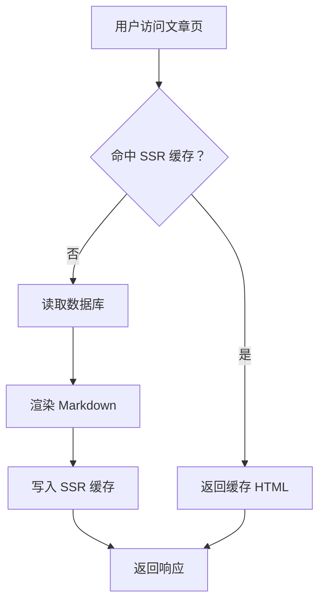

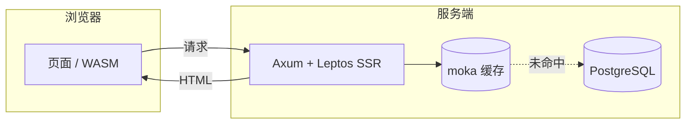

### 时序图

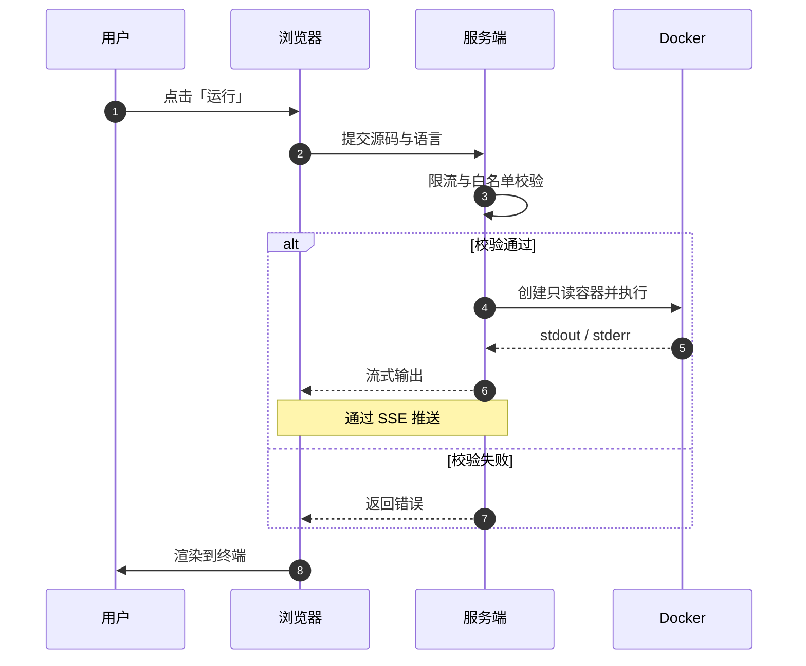

### 类图

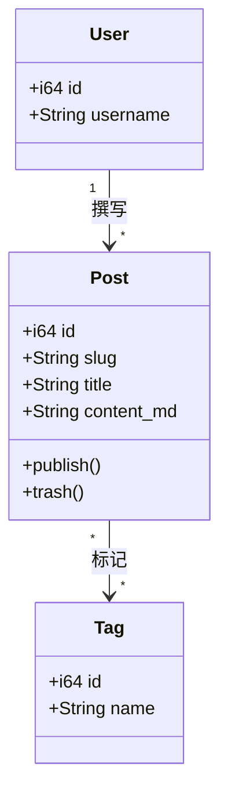

### 状态图

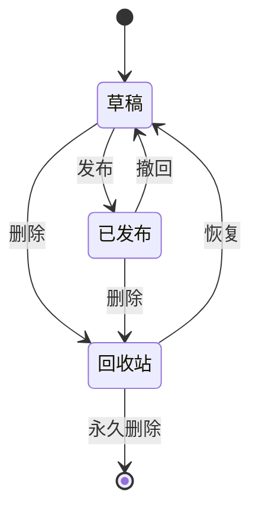

### 实体关系图

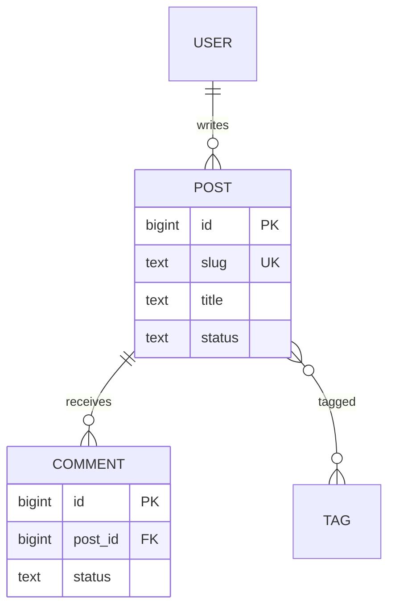

### 甘特图与时间线

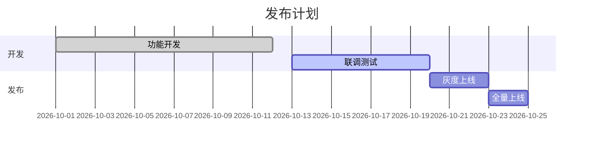

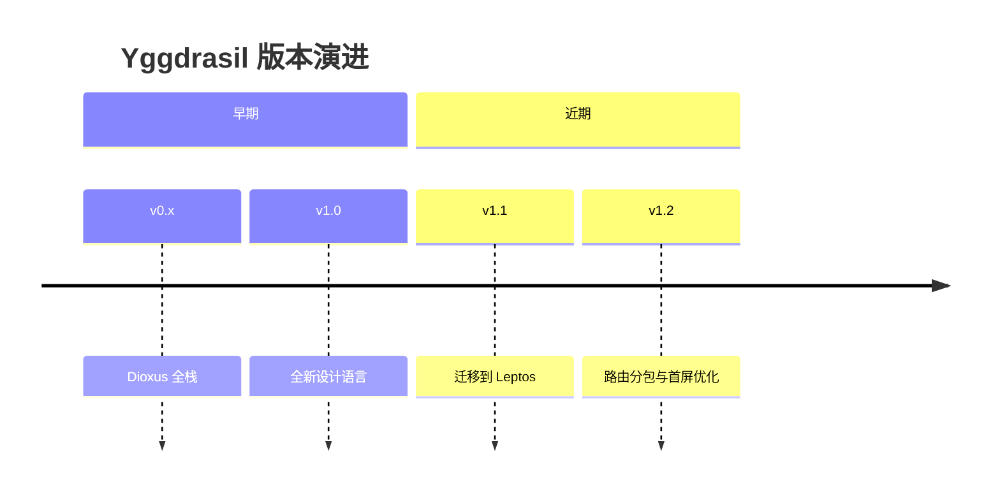

### Git 分支图

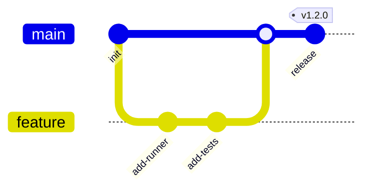

### 思维导图

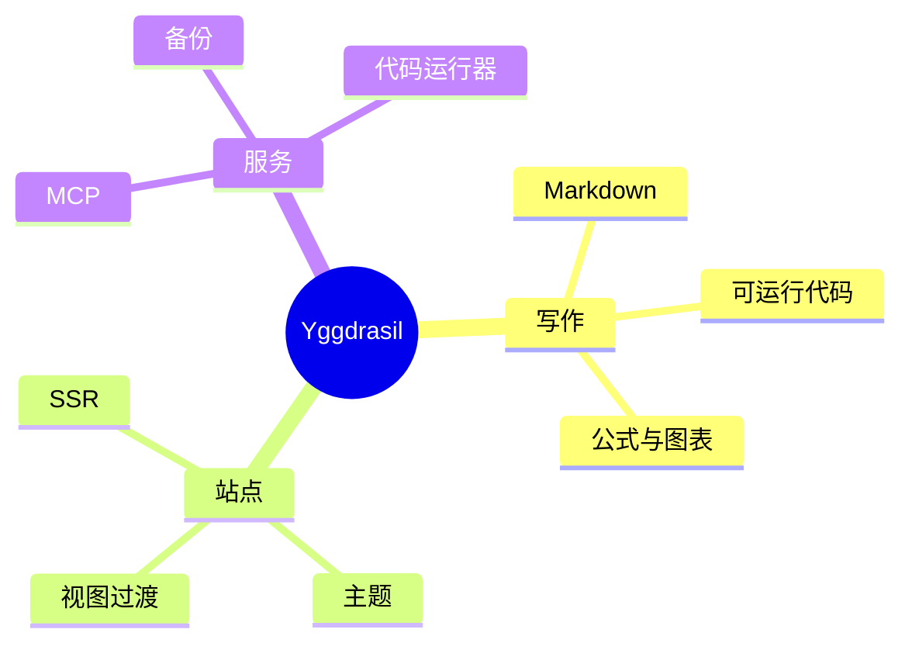

### 数据图表

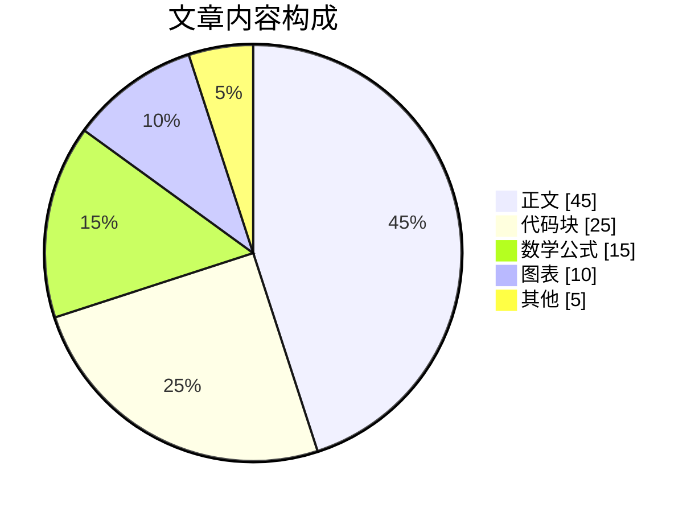

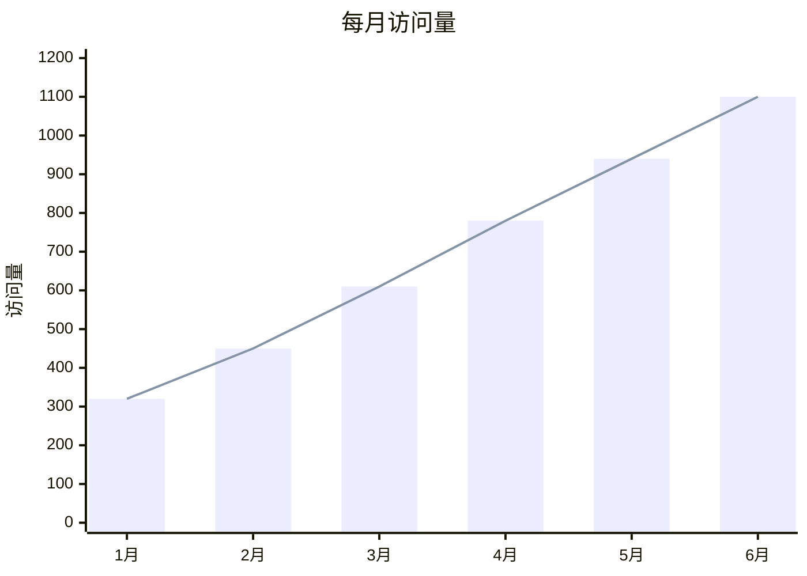

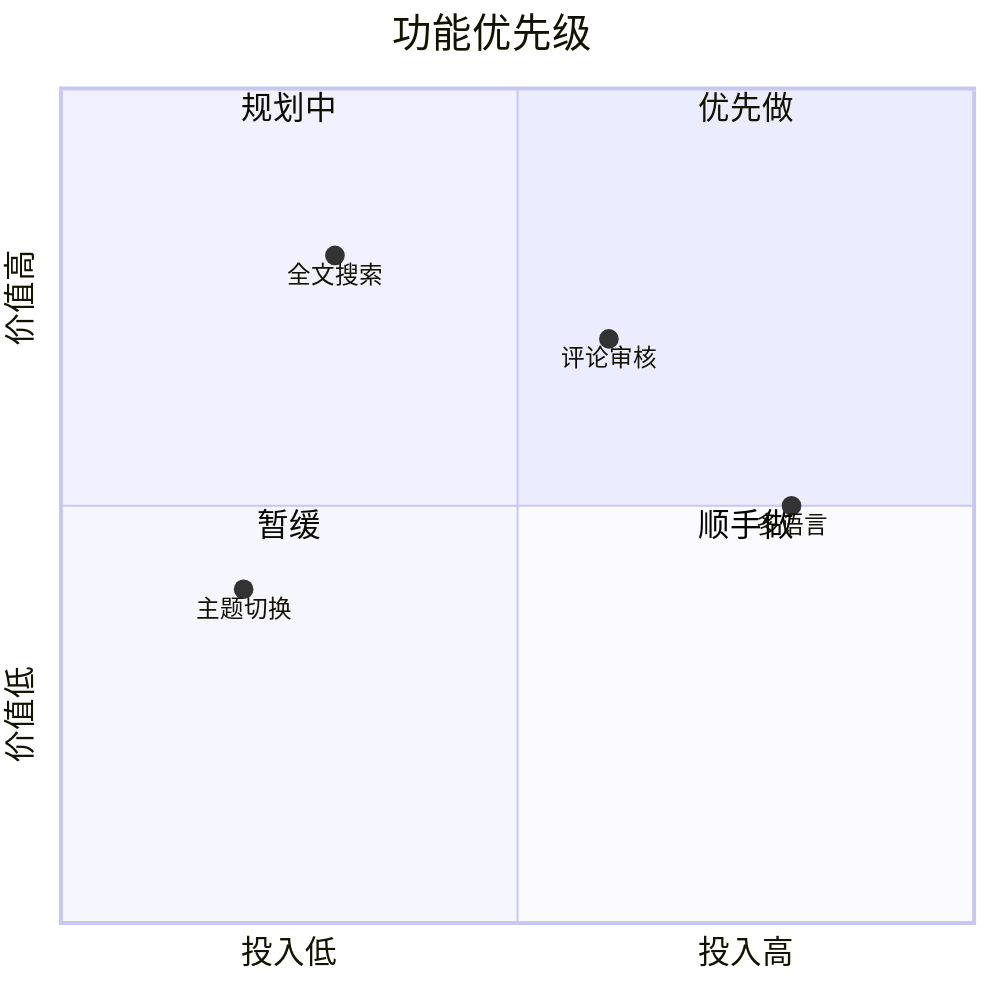

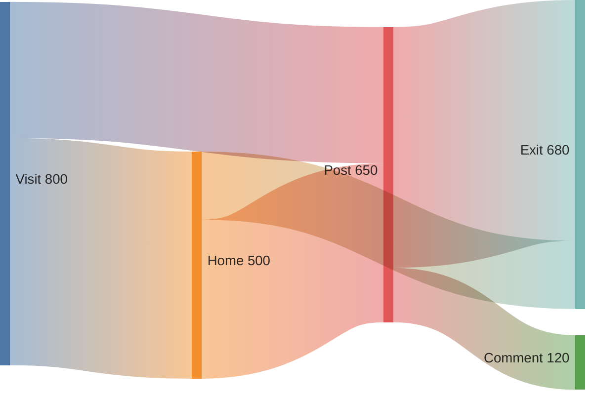

> [!NOTE]
> Mermaid 的桑基图词法只接受 ASCII 节点名，写中文节点会解析失败，上图因此使用英文标签。

### 用户旅程与看板

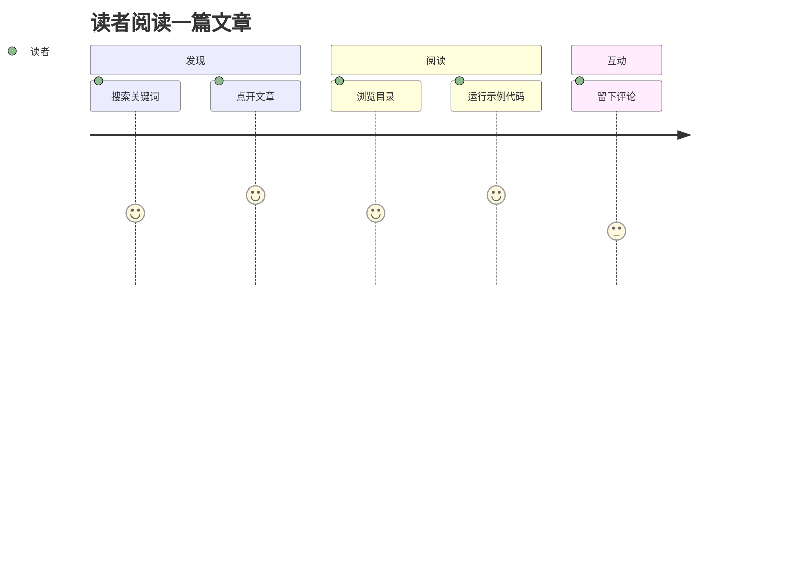

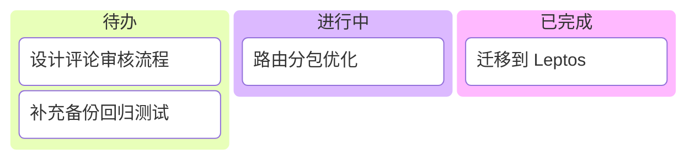

### 架构与块图


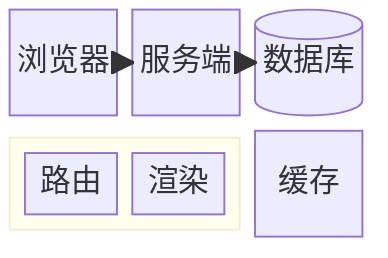

### 需求图与 C4 上下文图

需求图的元素名与关系只能用 ASCII 标识符，中文放进带引号的 `text` 与 `type` 里。

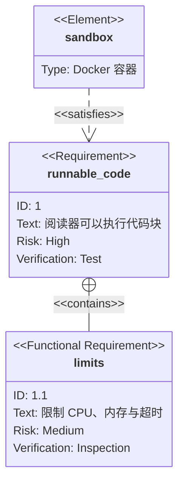

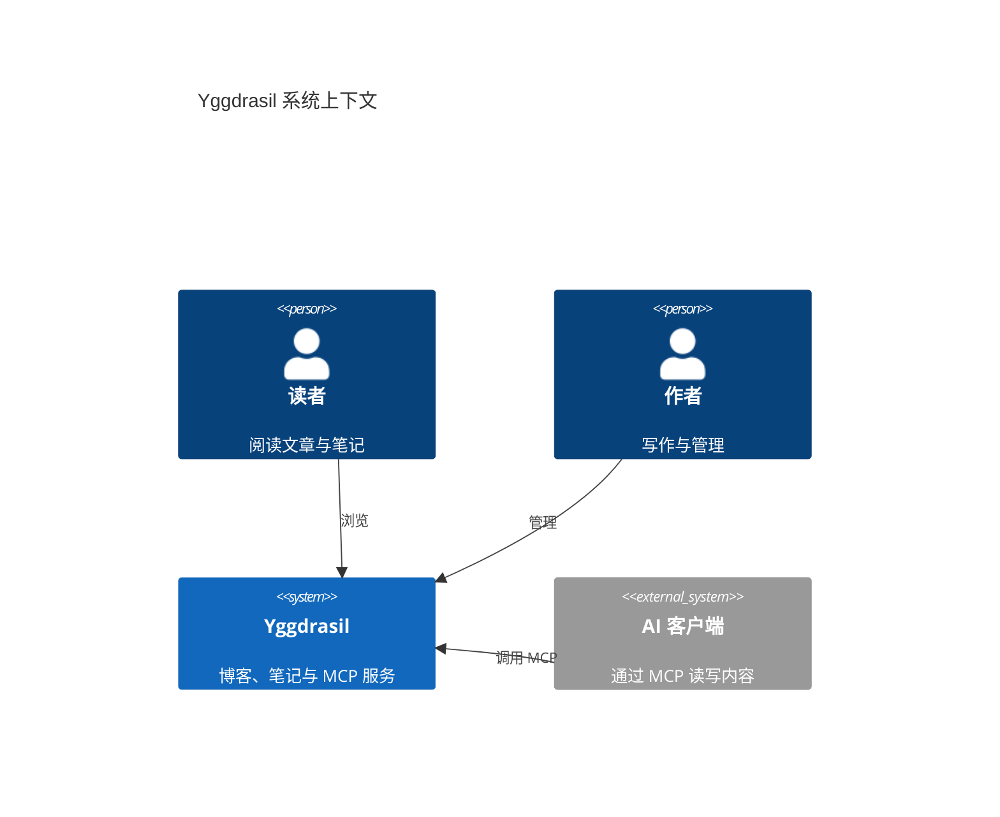

### 其他图表

```mermaid
packet-beta
    0-15: "源端口"
    16-31: "目的端口"
    32-63: "序列号"
    64-95: "确认号"
```

```mermaid
radar-beta
    title 三种方案对比
    axis a["性能"], b["可维护性"], c["体积"], d["生态"], e["学习成本"]
    curve x["方案 A"]{4, 3, 5, 2, 3}
    curve y["方案 B"]{3, 5, 3, 4, 4}
    max 5
```

```mermaid
treemap-beta
"站点"
    "前端"
        "主包": 290
        "路由分包": 480
    "服务端"
        "API": 120
        "运行器": 60
```

## 九、脚注

正文里可以引用 PostgreSQL[^pg]，也可以引用渲染管线用到的 pulldown-cmark[^pc]。同一条脚注可以被引用多次[^pg]，每次引用在定义末尾都有对应的返回链接。

脚注的标签可以含空格[^my note]，也可以写成多段，续段缩进四个空格[^long]。

## 十、链接与图片

### 链接

- 行内链接：[Leptos 官网](https://leptos.dev)
- 带标题的链接：[pulldown-cmark](https://docs.rs/pulldown-cmark "Rust 的 CommonMark 解析库")
- 自动链接：<https://github.com/VOD-Studio/yggdrasil>
- 站内链接：[回到文章列表](/archives)
- 页内锚点：[跳到可运行代码块](#shi-yi-ke-yun-xing-dai-ma-kuai)

### 图片与灯箱

图片带模糊占位与延迟加载，点击进入灯箱，可以缩放和拖动。


## 十一、可运行代码块

在围栏语言后加 `runnable`，阅读器就会在代码块下方挂出运行器：代码在服务端的 Docker 沙箱里执行，只读文件系统、无网络，输出以流的形式显示在终端里。每个示例都是独立的单文件程序。

### Python

```python runnable
from collections import Counter

text = "the quick brown fox jumps over the lazy dog the end"
counts = Counter(text.split())
for word, n in counts.most_common(3):
    print(f"{word}: {n}")
```

预期输出：`the: 3`、`quick: 1`、`brown: 1`。

### Node.js

围栏末尾可以追加紧凑的 JSON 来调整资源，五个字段必须写全，且不能含空白：

```javascript runnable {"cpu_cores":1.0,"memory_mb":256,"timeout_secs":10,"output_bytes":1048576,"allow_network":false}
const memo = new Map();
const fib = (n) => {
  if (n < 2) return BigInt(n);
  if (memo.has(n)) return memo.get(n);
  const v = fib(n - 1) + fib(n - 2);
  memo.set(n, v);
  return v;
};
console.log(`fib(90) = ${fib(90)}`);
console.log([1, 2, 3, 4].map((x) => x ** 2).join(", "));
```

预期输出：`fib(90) = 2880067194370816120` 与 `1, 4, 9, 16`。

### TypeScript（Bun）

```typescript runnable
interface Point {
  x: number;
  y: number;
}

const dist = (a: Point, b: Point): number => Math.hypot(a.x - b.x, a.y - b.y);

console.log(dist({ x: 0, y: 0 }, { x: 3, y: 4 }));
```

预期输出：`5`。

### Go

```go runnable
package main

import (
	"fmt"
	"sync"
)

func main() {
	var wg sync.WaitGroup
	results := make([]int, 5)
	for i := range results {
		wg.Add(1)
		go func(i int) {
			defer wg.Done()
			results[i] = i * i
		}(i)
	}
	wg.Wait()
	fmt.Println(results)
}
```

预期输出：`[0 1 4 9 16]`。

### Rust

```rust runnable
use std::collections::BTreeMap;

fn main() {
    let words = ["rust", "go", "rust", "python", "go", "rust"];
    let mut freq: BTreeMap<&str, usize> = BTreeMap::new();
    for w in words {
        *freq.entry(w).or_default() += 1;
    }
    for (w, n) in &freq {
        println!("{w}: {n}");
    }
}
```

预期输出：`go: 2`、`python: 1`、`rust: 3`。

> [!NOTE]
> 运行器不提供标准输入，也不开放网络。需要联网或读取本地文件的示例，请用不带 `runnable` 的普通代码块展示。

## 十二、折叠内容

<details>
<summary>点击展开：推导 1 + 2 + … + n</summary>

把求和式倒序再写一遍，两式相加，每一列的和都是 $n + 1$，一共 $n$ 列：

$$
2S = n(n+1) \quad\Rightarrow\quad S = \frac{n(n+1)}{2}
$$

折叠区域里可以继续使用 **Markdown**、`行内代码`，也可以放代码块：

```python
print(sum(range(1, 101)))  # 5050
```

</details>

<details>
<summary>点击展开：参考答案</summary>

答案是 `42`。

</details>

## 十三、分割线与转义

上方文字

---

中间文字

***

下方文字

以下字符前加反斜杠可以原样输出：\* 星号、\_ 下划线、\` 反引号、\# 井号、\[ 方括号 \]、\\ 反斜杠、\$ 美元符号。

## 十四、Unicode 与多语言

- 中文：世界，你好！
- 日本語：こんにちは世界
- 한국어：안녕하세요 세계
- العربية：مرحبا بالعالم
- Русский：Привет, мир
- Emoji：🚀 🦀 🌳 ✨ 📝 🔥

## 十五、混合排版压力测试

> 1. **引用 + 有序列表 + 强调**
> 2. 同时包含 `行内代码` 与[链接](https://example.com)。

下面这段同时出现公式 $f(x) = x^2$、`inline code`、**强调**、[超链接](https://example.com)和脚注[^mix]：

$$
\mathcal{F}\{f\}(\xi) = \int_{-\infty}^{\infty} f(x)\,e^{-2\pi i x \xi}\,\dd x
$$

```mermaid
flowchart TD
    A["Markdown 源码"] --> B{"解析"}
    B --> C["HTML"]
    B --> D["KaTeX 公式"]
    B --> E["syntect 高亮"]
    B --> F["Mermaid 占位"]
    C --> G["HTML 清理"]
    D --> G
    E --> G
    F --> G
    G --> H["SSR 缓存"]
    H --> I["客户端水合"]
    I --> J["Mermaid 懒加载渲染"]
```

**测试结束**：如果以上内容都渲染正确，说明 Markdown 管线工作正常。

[^pg]: PostgreSQL 是本项目使用的关系型数据库，通过 deadpool-postgres 管理连接池。

[^pc]: pulldown-cmark 是 Rust 生态中常用的 CommonMark 解析库，本站启用了表格、任务列表、脚注、数学公式与 GitHub 风格提示块等扩展。

[^my note]: 标签里的空格会在生成 id 时被清洗成连字符。

[^long]: 这是一条多段脚注的第一段。

    这是第二段，缩进四个空格后属于同一条脚注。

[^table-note]: 单元格里也可以放脚注引用。

[^mix]: 这条脚注用于混合排版测试。
