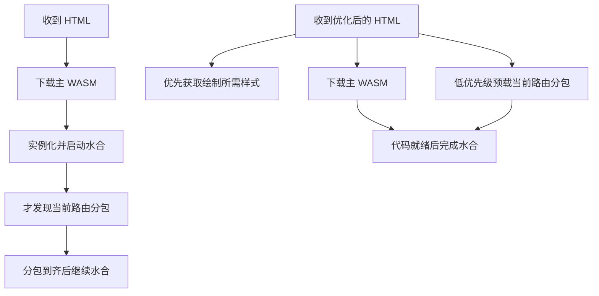

## 迁移之后，优化才真正开始

在[《从 Dioxus 到 Leptos：给 Yggdrasil 换一副骨架》](/post/yggdrasil-dioxus-to-leptos)里，我们记录了框架迁移的动机与过程：用真正的路由级 WASM 分包，替代 reader / full 两套客户端，让读者不必为永远不会打开的后台付费。

但迁移完成，并不意味着性能问题已经结束。

新的页面可以按需加载了，网络面板里却出现了几百个小请求；HTML 早早返回，正文仍然迟迟不出现；入口文件明明带着哈希，回访却还在整包下载。甚至有一次，为了加速首访而加入的 CDN 预热，反而让浏览器长期拿到更大的压缩文件。

这些现象提醒我们：**代码结构上的按需，不等于网络上的高效；单个资源足够小，也不等于整条访问路径足够短。**

这篇文章复盘迁移后到 v1.3.0 的几轮性能工程。重点不再是为什么选择 Leptos，而是如何沿着一次真实访问，把不必要的字节、请求、依赖和计算逐层拿掉。

> **数据范围**：本文数字来自 2026 年 10 月 28—31 日保存的线上测量、本地对照和发布记录，不代表此刻重新测得的线上成绩。不同轮次使用的文章、构建与网络条件有所区别，收益不能直接相加；移动端模拟与桌面不限速结果也不应混为一谈。[^measure]

## 先分清：页面究竟慢在哪里

一次访问至少有三个不同的终点：服务器开始返回内容，浏览器把内容画出来，以及客户端接管交互。

对应到测量上，我们分别观察 TTFB、FCP / LCP，以及项目自己的水合完成标记。它们有关联，却不是同一个指标。FCP 只说明首次内容绘制，不代表主正文全部出现；水合完成标记也不是完整的交互延迟评估。

当时源站即使绕过 HTML 缓存，SSR 也只需要约 14–25 ms，两台服务器负载接近零。真正突出的等待发生在浏览器拿到 HTML 之后：CSS 与预载请求争夺带宽，主包与分包串行启动，CDN 对小请求排队，回访资源无法复用。

因此，这轮工作的第一步不是优化 SQL，也不是给服务器加核心，而是把请求瀑布图展开。

下面是第一轮上线后的移动端对照。基线已经是迁移后的 v1.1.1，而不是 Dioxus；网络档位为 1.6 Mbps、150 ms RTT、CPU 降速 4 倍，时间单位为毫秒。

| 页面 | 基线 FCP | 第一轮后 FCP | 基线水合完成 | 第一轮后水合完成 | 基线总请求数 | 第一轮后总请求数 |
| --- | ---: | ---: | ---: | ---: | ---: | ---: |
| 首页 | 3464 | 1088 | 5106 | 3400 | 591 | 130 |
| 文章页 | 4892 | 1164 | 6864 | 4316 | 574 | 140 |
| 归档页 | 2372 | 1052 | 3900 | 3047 | 323 | 130 |
| 笔记页 | 3912 | 1072 | 5589 | 3701 | 485 | 114 |

这张表揭示了两个事实。首先，移除错误的加载策略，可以在没有改变业务功能的情况下明显提前绘制。其次，绘制和水合的改善幅度并不相同：用户已经看见页面之后，浏览器仍有代码下载、实例化与水合工作要完成。

**优化的对象不是某一个最好看的数字，而是这几个阶段之间的依赖关系。**

## 一、让分包边界真正成为付费边界

### 视图拆出去，数据代码也要拆出去

Leptos 的懒加载路由中，`LazyRoute::data()` 位于主包，页面视图则可以进入独立分包。这个设计有利于尽早启动数据加载，但也留下了一个容易忽略的入口：如果在主包里直接创建每个页面独有的 `Resource<Result<T, ApiError>>`，与 `T` 相关的数据类型、反序列化代码和 server function 客户端，就可能一起被带进主包。

结果是：后台界面没有下载，后台数据处理代码却仍然潜伏在所有页面的公共成本里。

Yggdrasil 用 `route_data` 把资源值统一为 JSON 文本，让不同路由共用同一套资源代码；取数函数使用 `#[leptos::lazy]`，页面解码逻辑则随视图分包加载。主包负责组织加载，不再承担每种页面数据的完整实现。

这里需要保持一个重要约束：资源在 `data()` 中创建，不能为了把代码移进分包，就把资源挪到 `view()`。SSR 可能多次执行懒路由的视图构建，把资源放错位置会重复创建资源，甚至破坏水合对应关系。后文会看到，即便遵守这个约束，请求内去重仍然是必要的。

### 泛型、日期和诊断信息，也有下载成本

围绕主包，我们又做了几项更细的调整。

首先是组件类型擦除。深层视图类型会带来大量单态化代码，`erase_components` 用统一的视图表示减少这部分展开。它必须在 SSR 与 WASM 两侧一致开启，否则两端产生的水合结构可能不匹配。体积开关在这里也是协议开关，不能只改浏览器构建。

其次是日期处理。页面只需要几种固定格式，就不必把通用 strftime 路径一起带入浏览器；服务端已经输出 RFC 3339，客户端也不必为宽松解析和其他日期格式保留整套解析路径。我们用固定格式函数替代通用格式化，并让浏览器 DTO 走严格 RFC 3339 反序列化，而不是移除整个 chrono。

发布 WASM 还关闭了 Debug 格式化和文件、行号信息。代价必须正视：`{:?}` 在浏览器发布构建中不再输出原来的内容，因此评论列表的 key、错误文案等不能依赖 Debug 表示。瘦身之前，先修掉这些把诊断输出当业务数据的用法。

底层构建继续采用体积优先配置，包括 `opt-level="z"`、fat LTO、标准库体积优化和 `immediate-abort`。它们不是无条件的运行速度优化，而是针对博客客户端的选择：以更小的传输和初始化负担，换取不追求极限计算吞吐的构建策略。

### 让页面专属的字符串也离开主包

还有一项优化发生在 `.rodata`，而不是函数代码里。

wasm-split 会尝试把页面专属的只读数据移进对应分包，但重排和对齐后的数据段如果超过输入空间，就可能放弃搬移，把整段留在主包。后台文案、图鉴样例和 class 字符串于是又回到了每位读者的下载路径。

`SPLIT_DATA_SLACK` 为这一步重排提供余量。它本身没有代码引用，不作为业务数据进入最终模块；作用是避免拆分器因为布局空间不足而退回不搬移的路径。这个处理在当时的产物上，让约 95 KB Brotli 的后台和图鉴只读数据不再滞留主包。

最后，发布装配剥离每个 WASM 里运行时不需要的 `producers` 和 `target_features` 自定义段。单个文件的元数据很小，重复出现在整个分包集合里，就成了值得清理的固定成本。剥离放在 cargo-leptos 完成分包和引用改写之后，避免提前处理空分包触发工具链问题。

这些调整与下一节的 CSS 拆分一起，留下了这样的发布记录：

| 项目 | 优化前 | 优化后 | 口径 |
| --- | ---: | ---: | --- |
| 主 WASM | 310,782 B | 287,544 B | v1.2.5，Brotli |
| 公开页阻塞样式 | 40,260 B | 24,896 B | 拆出后台样式，Brotli |

这不是一次“换个压缩器”的收益，而是把不属于公共路径的工作重新放回它该在的位置。

## 二、分包不是越碎越好

### HTTP/2 没有让请求成本归零

原版 wasm-split 按照“哪些懒加载点需要这段代码”切分共享模块。这个规则能精细描述代码共享关系，却不一定产生适合真实网络的资源布局。

当时 59 个懒加载点切出了 1121 个共享分包，半数不到 200 字节。每个小包的下载内容很少，但请求调度、CDN 处理和模块加载并不会因此消失。

我们先在 wasm-split 的 fork 中加入贪心合并：如果合并小分包的收益为正，就把它们合起来。随后再按线上环境，调高 `WASM_SPLIT_CHUNK_LOAD_COST`。

| 路由直开 | 未合并 | 合并代价 1024 | 合并代价 8192 |
| --- | ---: | ---: | ---: |
| 首页 WASM 文件数 | 227 | 60 | 21 |
| 文章页 WASM 文件数 | 379 | 70 | 26 |
| 归档页 WASM 文件数 | 123 | 32 | 11 |

这里统计的是路由直开需要的 WASM 文件，包含主包；不是整页所有资源请求数，也不是整个发布目录的文件数。

选择更大的合并代价，是因为真实 CDN 给出了不同于本地直连的答案。对当时的 EdgeOne 节点，同一客户端在一条 HTTP/2 连接上并发请求一批已命中的小文件，耗时随并发数量近似线性增加，折合每个请求约几毫秒。开发者工具里那些“小到只有一两 KB，却要等几百毫秒”的文件，慢的不只是传输，还有排队。

**HTTP/2 能复用连接，但不能替应用、边缘节点和浏览器消灭所有逐请求工作。**

### 为什么停在 8192

继续合并当然还能减少请求，但会让某些页面下载更多自己用不到的共享代码。合并不是免费午餐，只是用冗余字节交换更少的请求。

我们对多个代价参数重建同一份 Rust 产物，比较每条路由的文件数与 Brotli 总量。最终采用 8192：在当时的快慢网络之间取得折中，而不是追求最少文件数。相对上一轮，多数路由的首屏 WASM 总量变化控制在约 ±5%，少数较小页面会多出数十 KB。

因此，这个值不是 WebAssembly 的通用最佳实践，更不是 CDN 永久不变的常数。它是当前代码共享结构、网络带宽和逐请求开销共同决定的工程参数。

## 三、预载应该缩短关键路径，而不是抢占关键路径

### 从全部预载，到只预载当前页面

Leptos 当时的 SSR 集成会为调用过的懒加载函数展开分包预载，而且没有去重。首页 `<head>` 中曾出现 363 条 WASM preload，占去约 51 KB 原始 HTML。

更严重的问题不在 HTML 大小，而在优先级。弱网里，这些预载与 CSS 同时争抢带宽；浏览器在忙着为后续水合准备代码，却迟迟拿不到绘制当前页面所需的样式。

第一轮，我们去掉了这种预载洪泛。第二轮，再把真正有用的部分加回来：只为当前路由的视图依赖输出去重后的 preload，并使用 `fetchpriority="low"`；分包加载器则单独做 modulepreload。

低优先级并非装饰。第一版定向预载没有设置它，移动端 FCP 又出现倒退；降低优先级后，才同时保住绘制时间，并提前启动当前页面的分包下载。

在模拟 EdgeOne 排队行为的本地对照中，这轮调整连同进一步合包，让多数页面的移动端冷加载水合再提前约 150–250 ms，回访水合快约 30–40%；关于页没有得到同样的冷加载收益。这个结果属于本地控制实验，不能与前面的线上基准直接拼接。[^local]

### 把后台样式留在后台

CSS 的优化遵循同一原则。后台表格、管理面板和组件图鉴需要的样式，不应阻塞一位匿名读者打开文章。

于是我们把样式拆成公共入口和 `admin.css`。后者只在后台与图鉴页面加载：直达时由 SSR 输出，站内导航进入时再由相应路由补入。

这比仅仅让 CSS 文件变小更重要：它让“哪些页面需要哪些样式”成为显式契约，而不是默认把整个站点的样式都交给每次访问。

## 四、缓存的前提，是 URL 真正代表内容

### 有哈希的文件名，不一定是内容寻址

cargo-leptos 原先先计算入口文件名，随后才把分包加载器的名字写进入口。这意味着入口的最终内容可能变化，文件名却没有同步反映变化。

这种地址不能安全地缓存一年。否则新旧发布切换后，浏览器可能继续用旧入口引用已经删除的分包。

我们在发布装配的最后，按入口 JS、主 WASM 和分包加载器三者的最终内容重新计算名称，并在 `hash.txt` 写入 `entry: content-addressed`。只有具备这个标记的发布入口，服务端才允许返回长期不可变缓存；开发产物仍然按需校验。

区别不在于名字“看起来像哈希”，而在于能否保证：**内容改变，地址一定改变。**

### 为什么 `no-cache` 仍然导致整包重下

按 HTTP 语义，`no-cache` 允许存储，但复用前需要校验。我们最初也预期回访会走 ETag / 304。

然而当时通过 EdgeOne 实测，源站能返回 304，不代表整个链路就会这样工作：这些资源经过节点后仍然返回 200 和完整包体，条件请求没有按预期抵达源站。

所以，仅仅证明服务器的 ETag 正确，不足以证明读者的回访便宜。内容寻址之后，浏览器才能直接复用本地缓存，边缘节点也能安全地保留对象。

固定路径资源采用相同思想，但保留原文件路径：`style.css`、KaTeX、核心脚本、灯箱、编辑器和终端等，自动附加文件内容摘要 `?v=`。服务端把版本表随 HTML 下发，Rust 与浏览器端的动态加载都使用同一套版本信息。

这里还有一道保护：只有版本号与当前文件一致时，响应才是 `immutable`。滚动发布期间，旧页面带着旧查询参数请求到新文件时，不能把新内容以旧地址长期固化。

上一版 `/pkg/` 资源的保留窗口则继续服务于尚未刷新的旧标签页。长期缓存、版本切换与旧资源兼容是一组完整约束，不能只解决其中一个。

## 五、一次反向优化：为什么我们删除了 CDN 预热

预热看起来是自然的下一步：新版本发布后，提前让 CDN 拉取静态资源，第一位访客就不用回源。

但实际执行后，节点上相当一部分文件的 Brotli 大小比源站预压缩产物更大，而且显示为缓存命中。部署过程中还出现过主 WASM 长时间没有数据返回，页面一直无法水合。

沿着 nginx 日志追下去，原因才清楚：预热任务用 Range 请求拉取未压缩内容，没有按我们提供的 `Accept-Encoding: br` 获得源站 `.br`。节点缓存原文后，再用自己的压缩策略响应浏览器。

这不只是压缩等级的差异，还与“第一个请求是什么”有关。在当时的节点行为中，gzip 或 identity 请求先到，会影响后续浏览器拿到的表示形式。一次冷节点上的先到请求，可能改变一个不可变资源长期的实际传输大小。

我们尝试过把回源请求强制改成 br，但节点会把 br 原样发给未声明支持它的客户端。这破坏内容协商，不能作为解决方案。

最终处理是：

- 删除发布流程中的预热任务，由正常浏览器请求触发回源。
- 对指定静态文本资源，让不支持 br 的请求照常回源，但不写入节点缓存，避免抢先固化较大的表示形式。
- 清除已经被影响的缓存，再核对 CDN 实际响应与源站 `.br` 大小。
- 静态文件在构建期用 Brotli q11 生成旁路文件，由源站直接发送；动态 HTML 与 feed 使用 q7，在压缩率和请求时 CPU 开销之间取舍。

代价是新发布后，各节点的首批访问仍要付出回源等待；我们没有把这个代价藏起来。相较之下，让此后每次命中都长期多传一截内容，是更不划算的交换。[^cdn]

**缓存命中只说明拿到了缓存，不说明拿到的是最合适的缓存内容。**

## 六、别让同一份页面数据出现在 HTML 里三次

WASM 变小之后，我们又遇到一个不在 `.wasm` 里的大头：HTML 内嵌的水合数据。

前台布局把 `<Outlet/>` 包在 `<Suspense>` 里。Leptos 当时的 SSR 会多次遍历这棵子树，懒路由的预载数据只能被取走一次，后续选择又重新调用 `data()`。于是同一份页面数据被重复取得、重复序列化，最终在 HTML 中出现三份，客户端却只使用第一份。

数据库和服务缓存或许能缓解底层查询，但不能消除重复的资源创建、编码和响应数据。把问题交给 Brotli，也不等于重复工作已经不存在。

修复方式是请求级的 `RouteDataRegistry`：按“取数函数类型 + 参数值”复用路由资源。它与前面的资源类型擦除解决不同问题——前者消除同一次 SSR 中的重复实例，后者减少主包里的类型相关代码。

| 页面 HTML | 修复前 | 修复后 |
| --- | ---: | ---: |
| Markdown 全特性测试文章 | 5,135,022 B | 2,498,104 B |
| 首页 | 145,586 B | 105,310 B |
| 更新日志 | 808,181 B | 453,021 B |

这些是对应测试页面的未压缩 HTML 字节数，不是浏览器线上 Brotli 传输量。

注册表的生命周期必须限于一次请求：相同函数和参数可以复用，不同取数函数不能因为返回了相似内容就合并，更不能把请求内去重扩成跨用户共享状态。

这个问题也已作为 [leptos-rs/leptos#4985](https://github.com/leptos-rs/leptos/issues/4985) 向上游报告。它说明了 SSR 性能排查的一条实用原则：不只数接口请求，还要检查框架最终写进 HTML 的资源脚本。

## 七、把不属于读者的计算移到保存时

Mermaid 是另一类成本：图的内容在文章保存后基本不变，过去却由每位读者下载渲染库，再在主线程上重新解析、布局、绘制。主题切换时，还可能再次排版。

我们把这项工作移到了文章保存阶段。Rust 端使用 merman 渲染浅色、深色两份 SVG，和文章 HTML 一起存储；阅读页只负责展示、主题切换与点击放大，不再加载整套 Mermaid 排版引擎。编辑器预览也调用同一套服务端渲染，feed 则只输出浅色图。

历史浏览器记录中，每张图的排版会消耗约 160–370 ms 主线程时间。现在读者不再重复承担这段工作，但代价并非消失：保存时需要渲染，正文需要携带两套主题 SVG，浏览器仍要绘制 SVG。

### 服务端能画出来，还不够

迁移图表渲染后，新的正确性问题来自字体度量。服务端估算的标签宽度如果与浏览器真实字体不符，图虽然保存成功，文字仍可能溢出。

我们为多款常见字体生成字宽数据，按较保守的宽度进行布局，并在真实浏览器字体下核对标签。正文 CSS 中的任意位置换行与中西文自动间距，也要在图表容器内关闭，否则浏览器实际排版会偏离服务端计算。

配色同样不能只设置流程图节点色。甘特、ER、饼图、时间线和 C4 等图型具有专用变量，需要分别覆盖明暗主题。

这项优化的边界很清楚：**把可预先计算的内容提前计算，但不能用更低的显示正确性换更短的主线程时间。**

## 八、等待更短之外，过程也要连续

### 预取依据意图，而不是把全站搬到后台

首屏之后，用户通常会继续浏览。代码分包允许我们只下载目标页面，预取则把其中一部分等待移到点击之前。

Yggdrasil 对鼠标悬停、键盘聚焦设置短暂的意图延迟，避免指针偶然划过就发请求；触屏按下时立即启动预取。页面数据使用短期缓存，导航可以复用已经完成或仍在进行中的请求，错误不会长期留在缓存里。

没有悬停能力的设备，则在空闲期分批预取视口附近链接的代码，不自动批量读取页面数据。省流量模式与 2G 网络跳过预取，同一地址也有节流限制。

这样的设计不是“让每次点击都零等待”的保证。它只是利用可用的提前量，同时限制额外流量和服务端请求成本。

### 不把动画中断变成二次等待

另一些问题，网络面板未必能看见。

快速连续导航时，如果先跳过正在播放的视图过渡，再重新截图，刚进入的页面会突然恢复全亮，被冻结一段时间，然后再次淡出。用户看到的不是更快的响应，而是重复的视觉起步。

现在，动画已经开始播放后再导航，会在现有过渡中接力换页；截图更新期间收到的导航先记录，再在可执行时衔接。新旧正文使用互补的透明度曲线，避免交叉淡化中途两边同时变暗。

过渡截图阶段还会改变浏览器的命中测试，导致页头链接点击落到 `<html>`。协调器按坐标找回对应链接，被点击项则在截图期间保持按下标记，避免悬停色突然丢失。

对于真正慢的分包，我们不假装它已经完成：旧正文先保留，超过阈值再显示目标骨架与进度。水合完成前也不强行接管站内链接，而是允许浏览器正常整页跳转，避免中途换页导致水合失配、整个 WASM 停止工作。

这些改动未必让资源少一个字节，却能减少被吞掉的操作、重复动画与看似恢复后的失效状态。对读者而言，这也是性能的一部分。

### 去掉源站连接上的固定停顿

最后还有一个与前端框架无关、但会放大资源等待的小问题。

Axum 接入连接没有显式关闭 Nagle，hyper 分开写入响应头和包体，在 nginx 的 keepalive 链路上与延迟 ACK 叠加，形成约 40 ms 的固定等待。给连接设置 `TCP_NODELAY` 后，当时同一连接上的后续请求由约 40 ms 降到约 0.1 ms。

这不是全网 TTFB 都降到了这个数字，而是隔离了网络因素之后，连续请求场景里的源站等待被消除。一个正确的局部结论，不需要包装成更大的成绩。

## 九、让收益成为约束，而不是一张截图

性能优化如果只留下某次漂亮结果，很容易在下一轮功能开发中悄悄丢失。

Yggdrasil 因此保留了两类验证。一类回答“为什么”：同一份 Rust 产物只改变分包参数，通过本地 HTTP/2 对照隔离变量；对 CDN、条件请求和编码缓存，则直接测量真实链路。另一类回答“以后会不会退回去”：在发布回归中给资源和行为设预算。

当前发布脚本对每条公开路由检查首屏 Brotli WASM 不超过 594,603 B、WASM 文件数不超过 40，并核对当前路由预载范围、入口长期缓存、旧版本样式校验，以及 SSR 数据不重复序列化。

浏览器验证也不能止于“页面又出现了”。慢分包挂起后再后退或再次导航，需要继续进行一次真实切页，检查正文、文档身份与运行时错误，才能证明 WASM 仍然存活。

测量本身同样有边界：本地代理是否转发条件请求，会改变回访结果；忽略证书错误可能影响浏览器缓存；透明代理和 CDN 节点会引入波动。因此我们记录网络、CPU、缓存状态与测量方法，用多次中位数看趋势，而不是挑选最快的一次。

## 让系统少做一点，让读者少等一点

回看这些工作，最有效的改动常常不是让某段代码跑得更快，而是让它不必出现在这次访问里。

后台的代码与样式留在后台，当前页面的分包尽早上路；稳定的资源交给缓存，不变的图表在保存时计算；同一份 SSR 数据只创建一次，正在播放的过渡不再从头开始。

Leptos 提供了重新划分边界的能力，但最终体验仍由整条链路共同决定：编译器如何展开类型，拆分器如何组织模块，浏览器如何分配优先级，CDN 如何选择表示形式，以及发布之后旧页面如何继续工作。

原有的 HTML 缓存、数据缓存和重型编辑器按需加载，早于这次迁移就已存在。它们仍然重要，却不应被重新算作换框架带来的新增收益。相同地，本篇也不是 Leptos 与 Dioxus 的公平性能跑分，而是一个项目在新架构上持续清理成本的记录。

我们希望得到的，不是一组脱离场景的最低数字，而是一条更克制的访问路径：**读者走到哪里，系统才为哪里做必要的工作。**

## 资料与测量说明

- 前篇：[从 Dioxus 到 Leptos：给 Yggdrasil 换一副骨架](/post/yggdrasil-dioxus-to-leptos)。
- 项目源码：[VOD-Studio/yggdrasil](https://github.com/VOD-Studio/yggdrasil)。完整历史测量保存在仓库的 `docs/首屏性能实测-2026-10-28.md`，包含线上复测、本地对照及后续 CDN 压缩复查。
- 版本记录：[Yggdrasil 更新日志](/changelog)，对应 v1.1.0 至 v1.3.0。
- 关键实现：`src/hooks/ssr_resource.rs`、`src/app.rs`、`src/static_assets.rs`、`scripts/build-release.ts`、`scripts/test-release-split.ts` 与 `libs/yggdrasil-core/src/route-transitions.ts`。

[^measure]: 第一轮线上对照使用工作站无头 Chromium，新建上下文测冷缓存，同一上下文再次访问测回访，每格取三次中位数。移动档位为 390×844、DPR 3、1.6 Mbps、150 ms RTT、CPU 降速 4 倍。工作站经过透明代理，样本较少且存在抖动，因此只能支持这些条件下的趋势，不能当作真实用户监控的分位数。

[^local]: 第二轮本地对照在两份 release 前分别放置 HTTP/2 TLS 代理，按请求到达顺序逐个处理、每个增加 2.5 ms，用于模拟当时观测到的 EdgeOne 排队。它帮助隔离合包与预载的作用，但不等价于所有边缘节点的真实服务模型。

[^cdn]: 这里描述的是当时该站点 EdgeOne 套餐、配置与节点的实测行为，不是对所有 CDN 的通用结论。删除预热不代表预热天然无效；问题在于该任务的回源方式和缓存表示没有满足我们对压缩内容的要求。
