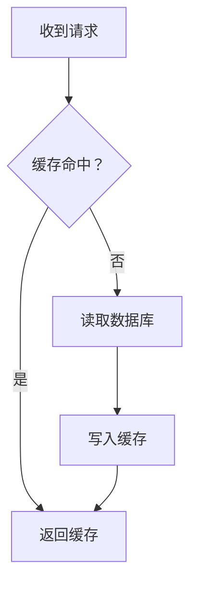
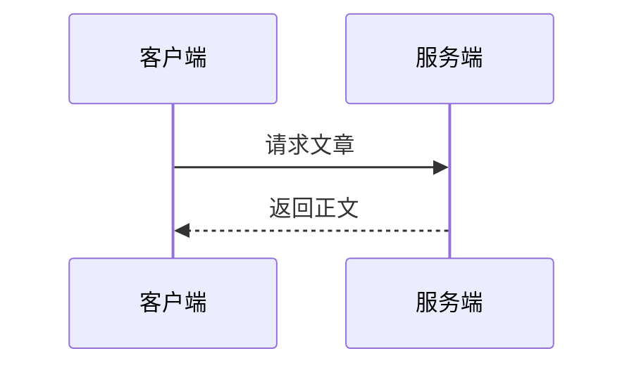
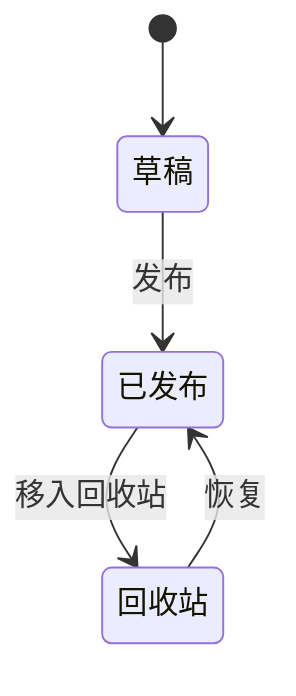

> **提示：** 这是一篇逐项验证站内 Markdown 渲染能力的测试文章。每个小节演示一类语法；文中标注「会被清理」「不支持」的写法都已在当前版本实测确认。发现渲染异常时，对照小节标题即可定位到对应语法。

## 一、基础文本与行内格式

普通段落文本，包含 **粗体**、*斜体*、***粗斜体***、~~删除线~~、`行内代码`。

上标与下标用 `^…^` 与 `~…~`，定界符必须与字母数字分开：质能方程可写作 E = mc ^2^，水分子可写作 H ~2~ O。紧贴单词的 `x^2^`、`H~2~O` 不会被解析，这类位置改用 `<sup>`、`<sub>`。

转义字符：\*这不是斜体\*、\`这不是行内代码\`；HTML 实体：&copy; &amp; &lt; &gt;。

行尾两个空格触发硬换行：  
这一行在源码里紧跟上一行，但会另起一行显示。

行内 HTML：<kbd>Ctrl</kbd> + <kbd>C</kbd> 复制，<mark>高亮文本</mark>，<abbr title="HyperText Markup Language">HTML</abbr>，H<sub>2</sub>O，E=mc<sup>2</sup>。

原始 HTML 只保留白名单内的标签与属性：<abbr title="…"> 的 `title` 会留下，而 `<time datetime="2026-10-23">` 只会保留 `<time>` 标签本身，`datetime` 属性被剥掉。

智能标点由解析器处理：`--` 变连接号、`...` 变省略号、"双引号" 与 '单引号' 变弯引号。

## 二、链接

- 内联链接：[示例站点](https://example.com "悬停标题")
- 自动链接：<https://example.com>
- 参考式链接：[写作指南][guide]（定义在文末）
- 站内链接：[写作指南页](/about/writing)
- 锚点链接：[回到本节开头](#er-lian-jie)
- 邮件地址：<mailto:hi@example.com>
- 裸 URL 不会自动成链：https://example.com/plain

站内锚点用的是系统生成的 id：中文标题会被转成拼音 slug（如「二、链接」→ `#er-lian-jie`），写中文原文不会跳转。锚点地址可以直接从目录里的链接复制。

## 三、标题层级与目录

宽屏右侧、窄屏抽屉的目录由系统按 H2–H6 自动生成，标题自带锚点，不需要手写目录或锚点标签。标题内允许行内代码：

### 三级标题示例

#### 四级标题示例

##### 五级标题示例

###### 六级标题示例

### 带行内代码的标题：`render_markdown_enhanced`

标题后面写自定义属性（如 `### 标题 {#custom-id}`）不会生效：锚点统一由系统按标题文本生成，`#custom-id` 会被丢弃。

## 四、引用与 GFM 提示块

> 这是一段普通引用。
>
> > 引用可以嵌套，内层沿用同一套样式。

> [!NOTE]
> 提示块使用 GitHub 风格的 `> [!NOTE]` 语法，支持五种类型。

> [!TIP]
> `> [!TIP]` 适合放实践经验。

> [!IMPORTANT]
> `> [!IMPORTANT]` 用于必须看到的信息。

> [!WARNING]
> `> [!WARNING]` 用于警告。

> [!CAUTION]
> `> [!CAUTION]` 用于高风险操作提醒。

## 五、列表

无序列表与嵌套：

- 第一项
- 第二项
  - 嵌套项（缩进两个空格）
  - 另一个嵌套项
- 第三项

有序列表（从 3 开始编号）：

3. 第三步
4. 第四步
5. 第五步

任务列表（阅读页只展示完成状态，不是可点击保存的清单）：

- [x] 已完成的条目
- [ ] 未完成的条目
  - [x] 嵌套的已完成条目
  - [ ] 嵌套的未完成条目

定义列表（CommonMark-HS 扩展语法）：

术语 A
: 术语 A 的定义，用冒号缩进。

术语 B
: 第一个定义。
: 第二个定义。

列表项里也能放代码块与公式：

1. 第一项带代码块：

   ```python
   print('列表内的代码块')
   ```

2. 第二项带公式：$\sum_{i=1}^{3} i = 6$

## 六、表格

| 左对齐 | 居中 | 右对齐 |
| :--- | :---: | ---: |
| 普通文本 | **粗体** | `代码` |
| 公式 $e^{i\pi}+1=0$ | [链接](https://example.com) | ~~删除线~~ |
| 脚注引用[^table] | 上标 x^2^ | 下标 H~2~O |

宽表格会套一层可横向滚动的容器，窄屏下不会被裁切：

| 列 1 | 列 2 | 列 3 | 列 4 | 列 5 | 列 6 | 列 7 | 列 8 |
| --- | --- | --- | --- | --- | --- | --- | --- |
| A1 | B1 | C1 | D1 | E1 | F1 | G1 | H1 |
| A2 | B2 | C2 | D2 | E2 | F2 | G2 | H2 |

`:---`、`:---:`、`---:` 这类对齐标记语法上被接受，但渲染结果不携带任何对齐属性，列的对齐与宽度由站点样式统一决定。

## 七、代码块

不带语言的围栏只做转义展示，没有语言标签：

```
纯文本代码块，不指定语言就没有高亮。
```

带语言标记的围栏由服务端语法高亮，右上角有复制按钮：

```rust
fn main() {
    let nums = [2, 4, 6];
    println!("sum = {}", nums.iter().sum::<i32>());
}
```

```python
from dataclasses import dataclass

@dataclass
class Point:
    x: float
    y: float
```

```javascript
const square = (n) => n * n;
console.log(square(7));
```

```go
package main

import "fmt"

func main() { fmt.Println("hello") }
```

```sql
SELECT p.title, count(c.id) AS n
FROM posts p LEFT JOIN comments c ON c.post_id = p.id
GROUP BY p.title ORDER BY n DESC;
```

```bash
cargo test --locked --all-features
```

```json
{ "status": "published", "tags": ["rust", "dioxus"] }
```

```yaml
status: published
tags:
  - rust
```

### 可运行代码块

围栏信息里加 `runnable` 才会在阅读页挂上运行按钮（依赖部署启用 Docker 运行器）；普通代码块只有高亮与复制。

```python runnable
nums = [2, 4, 6]
print("sum =", sum(nums))
```

```node runnable
const square = (n) => n * n;
console.log('square(7) =', square(7));
```

```typescript runnable
const square = (n: number): number => n * n;
console.log(square(7));
```

```go runnable
package main

import "fmt"

func main() {
	total := 0
	for i := 1; i <= 10; i++ {
		total += i
	}
	fmt.Println("total =", total)
}
```

```rust runnable
fn main() {
    let total: u32 = (1..=10).sum();
    println!("total = {total}");
}
```

覆盖资源限制时，JSON 必须紧凑地写在同一行且五个字段齐全，否则整行被忽略：

```python runnable {"cpu_cores":1.0,"memory_mb":256,"timeout_secs":10,"output_bytes":1048576,"allow_network":false}
print(sum(range(1000)))
```

运行语言白名单外的语言（如 ruby）即使写了 `runnable` 也只当普通代码块：

```ruby runnable
puts "ruby 不在运行语言白名单内"
```

### Mermaid 图表

语言标记恰为 `mermaid` 的围栏由浏览器渲染成图，跟随明暗主题，支持点击放大与缩放平移：







Mermaid 代码块不注入复制按钮，源码也不做服务端高亮。

## 八、数学、物理与化学公式

行内公式用 `$...$`：圆面积 $S = \pi r^2$，时间复杂度 $O(n \log n)$，向量点积 $\vec{a} \cdot \vec{b}$。

块级公式用 `$$...$$`，独占一行居中：

$$
\sum_{i=1}^{n} i = \frac{n(n+1)}{2}
$$

$$
\int_{0}^{\infty} e^{-x^2}\,\mathrm{d}x = \frac{\sqrt{\pi}}{2}
$$

$$
\begin{pmatrix} a & b \\ c & d \end{pmatrix}
\begin{pmatrix} x \\ y \end{pmatrix}
= \begin{pmatrix} ax+by \\ cx+dy \end{pmatrix}
$$

$$
\lim_{n \to \infty} \left(1 + \frac{1}{n}\right)^n = e
$$

公式里可以放中文与标点：$\text{斜率} = \frac{\Delta y}{\Delta x}$。

项目额外注册的物理宏表（对齐 LaTeX `physics` 宏包的一部分）：

- 微分与偏导：$\dv{f}{x}$、$\pdv{f}{t}$、$\dd{x}$
- 场算子：梯度 $\grad \varphi$、散度 $\divg \vec{E}$、旋度 $\curl \vec{B}$
- 数集：$\RR$、$\ZZ$、$\NN$、$\QQ$、$\CC$
- Dirac 记号：$\bra{\phi}$、$\ket{\psi}$、$\braket{\phi}{\psi}$、$\expval{A}$
- 定界符与向量：$\abs{x}$、$\norm{v}$、$\vu{r}$、$\qty{\frac{a}{b}}$

注意 `\div` 仍是除号（$a \div b$），散度要用 `\divg`。

化学公式与物理单位（KaTeX + mhchem）：

$$
\ce{2H2 + O2 -> 2H2O}
$$

$$
\ce{CO2 + H2O <=> H2CO3}
$$

温度 $\pu{298 K}$、浓度 $\pu{0.1 mol//L}$。

写成对出现的 `$` 才是公式；`echo $PATH` 这类文本建议放进行内代码，避免被误判成公式。

## 九、脚注

脚注使用 GFM 语法，系统自动编号，定义统一放在文末[^why]。

同一个脚注标签可以重复引用[^multi]，重复引用会在定义末尾生成多个回链[^multi]。

多段脚注的续段缩进四个空格，空一行继续写就是第二段[^long]。

## 十、图片、折叠块与原始 HTML

站内图片走 blur-up 双层加载：先出低分辨率占位图，再换原图，点击可放大（灯箱）：


站内图片不要加 `"标题"`：渲染器只包装 `src` + `alt` 结构的图片，带 `title` 的站内图会退回普通 ``，失去 blur-up 与灯箱。外链图片无论如何都保持原样：


折叠内容需要手写原始 HTML；后台富文本编辑器没有折叠节点，重复保存可能丢失：

<details>
<summary>查看补充说明</summary>

标签与内容之间要保留空行，内部的 Markdown 与公式才会被解析：

$$
\ce{2H2 + O2 -> 2H2O}
$$

</details>

会被保留的原始 HTML：`<kbd>`、`<mark>`、`<abbr>`、`<sup>`、`<sub>`、`<time>`、`<figure>`、`<dl>`、`<details>`。

会被清理的内容：`<script>`、`<style>`、`<iframe>`、`<object>`、`<form>`、`<meta>`、`<base>`，以及所有 `on*` 事件属性与 `javascript:` 链接（正文不执行脚本、不接受任意远端嵌入）。标题里的自定义 `id` 也会被丢弃。

## 十一、分隔线、元数据与不支持的写法

三个以上的短横线生成分隔线：

---

本文正文不使用 YAML frontmatter：标题、摘要、标签、封面、发布时间都是文章字段；frontmatter 会被解析成元数据块然后丢弃，不会渲染出来。

以下写法当前不支持，写了不会报错但不会按预期呈现：

- MDX 组件、`:::tip` 之类容器语法、`!!` 感叹块
- `==高亮==`（需要 `<mark>` 代替）
- Obsidian 双链 `[[某页]]`：会被解析成链接，但地址被清空，得到不可点击的 `<a>`，实际不可用
- 表格单元格里的块级元素（单元格只支持行内语法）
- HTML 注释 `<!-- … -->` 会被整段移除
- 用中文全角符号代替 Markdown 标记（如全角星号 `＊＊` 不起作用）

最后一条建议：可运行示例、Mermaid 图与公式只在确有帮助时使用，堆在一起会让正文难以阅读。

[^why]: 站内所有正文共用同一套渲染管线：pulldown-cmark 两遍遍历、KaTeX 与 mhchem、服务端语法高亮、最后统一走 HTML 清理，所以本页结论对文章、写作指南与更新日志同时成立。
[^multi]: 重复引用同一个标签时显示编号不变，定义末尾会追加带数字上标的回链。
[^long]: 多段脚注的第一段。
    这是缩进四空格的续行，并入第一段而不是变成代码块。

    空一行后再缩进四空格，就是同一个脚注里的第二个段落。
[^table]: 表格单元格里同样可以引用脚注。

[guide]: /about/writing "站内写作指南"