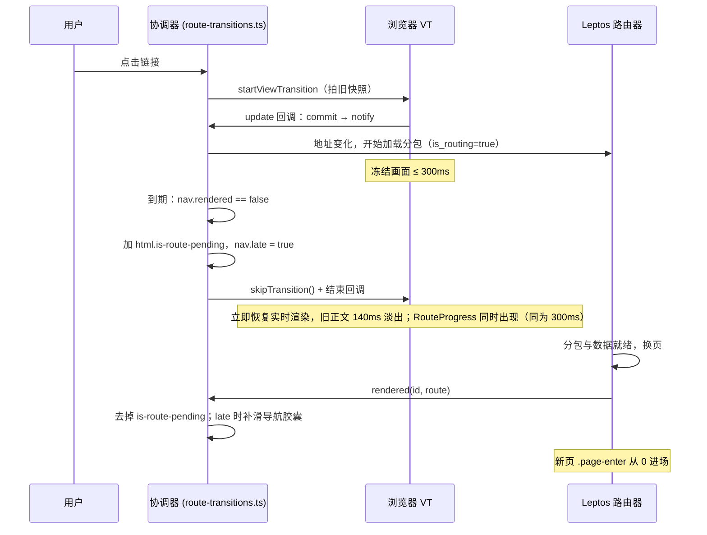

# 切页挂起淡出：分包迟到时旧正文淡出，消除切页闪白

## Context

现象（录屏 2026-10-26，`make dev`，DevTools 勾选 Disable cache）：首页点文章，地址栏在 2.383s 变成 `/post/...`，首页原样停留到 4.60s；4.617s、4.633s 两帧只剩页头、正文全空；4.65–4.73s 文章标题、正文依次淡入。用户感知为“闪一下才进文章页”。

本机无头 Chromium 复现（接管 `pushState` / `startViewTransition` 打点）：

| 场景 | VT 回调结束（拍新快照） | 新快照的 `main h1` | 文章 DOM 插入 |
|---|---|---|---|
| 缓存命中 | 376ms | 仍是首页“慢慢读源码…” | ≈442ms |
| 禁用缓存 | — | — | 2100ms，此时 `is-route-transitioning=false`、无 `data-vt-enter-handled`、标题所在 `.page-enter` 的 `opacity` 为 0 |

禁用缓存时 `split___post_route_view` 452→2009ms、`get_public_post_by_slug` 558→2013ms，单次跳转约 240–290 个 wasm 请求（dev 的 `target/site/pkg` 有 2467 个 `.wasm`，HTTP/1.1 同主机 6 连接排队）。

机制：

1. 点击后 `RouteTransitions.start` 开 VT，update 回调里 `commit()` 再 `waitForDestination()`。
2. 300ms（`WAIT_MS`，`route-transitions.ts:15`）到期，`window.setTimeout(complete, …)`（`route-transitions.ts:636`）强制放行。Leptos 懒加载路由分包未就绪时路由器保留旧出口（`src/components/frontend_layout.rs:178` 注释），新快照就是旧页面，过渡是“旧→旧”，看不出变化。
3. `commit()` 已移除 `data-vt-enter-handled`（`route-transitions.ts:538`）。之后 Leptos 在 VT 之外换页：旧 DOM 同步移除，新页 `.page-enter`（`styles/base.css` 的 `page-enter` 关键帧）从 `opacity: 0` 起步，按 `--enter-index` 每块错开 40ms。
4. 结果：满屏旧内容 → 一帧空白 → 淡入。切页超过 300ms 必然出现；dev / 冷缓存只是放大。

分两种“慢”，路由器表现不同：

| 情况 | 路由器表现 | 到期时 DOM | 现状 | 本计划 |
|---|---|---|---|---|
| 分包已加载、接口慢 | 立即挂新页，页面 `Suspense` 显示骨架屏 | 新页（骨架屏） | VT 旧→骨架屏，正常（`scripts/test-view-transitions.cjs` 的 `slowResponse` 已覆盖） | 不动 |
| 分包未加载 | 挂起换页，旧页面留在出口 | 旧页面 | 旧→旧空过渡，事后硬切 | 新增“挂起”分支 |

终态：到期时目标页仍未提交，就跳过这次 VT，旧正文按 CSS 淡出（与 `RouteProgress` 进度条同在 300ms 出现）；新页挂载时撤销淡出，由页面自身 `.page-enter` 进场。只改 `libs/yggdrasil-core` 的 JS/CSS，Rust 不改。

与 `docs/plan/链接预取_PLAN.md` 互补：预取减少迟到次数，本计划处理仍会迟到的情况（冷缓存、慢网络、触屏未预取）。

## 执行须知

- 开始前 `git status --short`；工作树有不属于本计划的改动时不要混进提交。
- 不手改生成产物（`public/<lib>/`、`target/`）；JS/CSS 改动用 `make build-libs` 或 `make dev-assets` 重建。
- 不改任何 Rust 视图；水合必须与 SSR 一致。
- 不在范围内：减少动态效果、不支持 VT、同页 hash（均走 `animate=false`，无等待，原地硬切，符合预期）；提前加载分包（见链接预取计划）。
- 验证通过后单独提交：`fix(navigation): 分包迟到时旧正文淡出，消除切页闪白`。

## 时序



用户看到：最多冻结 300ms → 旧正文淡出 + 进度条 → 新页淡入。没有“满屏 → 空白”的一帧硬切。

## 设计决定

| 问题 | 决定 | 理由 |
|---|---|---|
| 到期时 VT 怎么办 | `skipTransition()` | 新快照就是旧页面，播完是 200ms 空动画，期间 `::view-transition` 覆盖层还挡点击。跳过后浏览器立即恢复实时渲染，淡出由 CSS 在真实 DOM 上做。规范：回调阶段跳过不会再次调用回调。 |
| 迟到判定 | 到期时 `!nav.cancelled && !nav.rendered` | `rendered` 只在路由出口真正提交新页后由 `RouteMarker` 置真；接口慢的骨架屏路径已提交，不会误判。 |
| 状态归属 | 协调器，`<html>` 类 `is-route-pending` | VT 归协调器管，跳过只能由它做；与 `is-route-transitioning` / `is-theme-transitioning` 同族。Rust 的 `is_routing` 不知道 VT，不用它驱动。 |
| 淡出对象 | `main:not(main main)` | 命中前台 `FrontendShell` 的 `main`、后台 `src/components/admin_layout.rs` 的 `<main class=main_class>`、登录页 `main.auth-panel`；排除写作页嵌套的 `main.write-main` 与图鉴预览里的 `FrontendShell`。页头、页脚、`SearchPalette`、`RouteProgress`、Toast 都在 `main` 外。无需改 Rust。 |
| 淡出方式 | `animation: vt-fade-out 140ms var(--ease-out-expo) forwards`，不用 `transition` | 跳过后第一帧才开始渲染，transition 依赖之前的计算值不可靠；animation 在撤类时立即回到 `opacity: 1`，不和新页进场叠加。140ms 与栏目退出 `vt-section-out` 一致。 |
| 交互 | 淡出期间 `pointer-events: none` | 看不见的旧链接不可点；页头仍可点，可中途改道。 |
| 撤销时机 | 当前导航的 `rendered()`；`onPageHide`；`disconnect` | 挂起期间又发起新导航：新导航渲染前保持淡出，避免旧内容闪回；新导航按时渲染时在其 update 回调内撤销，新快照可见，过渡为“空白→新页”。 |
| 进场 | 不处理 | `commit()` 已去掉 `data-vt-enter-handled`，迟到路径不调 `markPageEntryHandled`，`.page-enter` 照常播放。 |
| 导航胶囊 | late 时在 `rendered()` 里调 `slidePill(nav)` | 跳过后 `ready` 被拒，原本挂在其上的滑动不执行；页头激活项跟随已提交路由（`use_rendered_route`），换页时才变。`slidePill` 用实时元素的 `animate()`，不依赖 VT。 |

## 改动

### 1. `libs/yggdrasil-core/src/route-transitions.ts`

```ts
const PENDING_CLASS = 'is-route-pending';

interface Navigation {
  // …
  /** 等待到期时目标页仍未提交：已跳过 VT，旧正文淡出，等迟到的 rendered 收尾。 */
  late: boolean;
}

// start()：nav 字面量加 late: false

// waitForDestination()：计时器改调 expire
const expire = () => {
  if (!nav.cancelled && !nav.rendered) {
    this.defer(nav);
    release();
    return;
  }
  complete();
};
const timer = window.setTimeout(expire, Math.max(0, nav.deadline - performance.now()));

private defer(nav: Navigation): void {
  nav.late = true;
  document.documentElement.classList.add(PENDING_CLASS);
  // 新快照只会是旧页面：跳过动画，恢复实时渲染，让旧正文按 CSS 淡出。
  nav.vt?.skipTransition();
}

private clearPending(): void {
  document.documentElement.classList.remove(PENDING_CLASS);
}

rendered = (id: number, route: string): void => {
  if (page(route) !== page(this.displayed) || id !== this.sequence) return;
  const nav = this.navigation;
  if (!nav?.committed || nav.id !== id) return;
  nav.rendered = true;
  this.clearPending();
  this.correctScroll(nav);
  if (nav.late) this.slidePill(nav);
  if (nav.cancelled) this.startScrollRestoration(nav);
  nav.attempt?.();
};

// onPageHide()、disconnect()：各加 this.clearPending()
```

- `release()` 结束 update 回调，`vt.finished` 随后触发 `finish(nav)`：`cleanNames`、移除 `is-route-transitioning`、`owner.finish()` 照旧；`is-route-pending` 不在此清除。
- 迟到路径不再执行 `complete()` 里的 `assignShell`、共享标题/封面命名（VT 已跳过）；`start()` 阶段已命名的元素由 `finish(nav)` 的 `cleanNames` 还原。
- 实施时以当时的 `rendered` 实现为准，只插入 `clearPending()` 与 late 补滑两行。

### 2. `libs/yggdrasil-core/src/style.css`（`vt-fade-out` 关键帧附近）

```css
/* 目标页分包超出 300ms 等待预算仍未就绪：协调器跳过空过渡，旧正文淡出，
   新页面挂载时撤销，由页面自身进场动画接上。只匹配最外层 main。 */
html.is-route-pending main:not(main main) {
  animation: vt-fade-out 140ms var(--ease-out-expo) forwards;
  pointer-events: none;
}
```

### 3. `src/app.rs` `shell`

- `yggdrasil-core.css?v=N` 与 `yggdrasil-core.js?v=N` 各加 1（以实施时的当前值为准）。

## 边界

| 场景 | 预期 |
|---|---|
| 到期前刚换页，`RouteMarker` 的 `set_timeout(0)` 还没调 `rendered` | 误判为迟到：VT 被跳过、新页直接显示，可能一帧 `opacity:0` 的 `main`，下一任务撤销；观感等同进场，可接受。 |
| 挂起期间浏览器后退回到正在显示的页面 | 新导航的 `rendered` 先于 `complete` 撤销淡出，新快照为完整旧页，过渡“空白→旧页”；分包到达后路由器按当前地址渲染，不应切走。需回归验证。 |
| 挂起期间点另一个慢页面 | 淡出保持；新导航到期再进迟到分支，状态不变。 |
| 挂起期间切主题 | 原 owner 已结束，主题不取消路由；`main` 透明，两张快照都看不到。 |
| 栏目切换（`data-vt-section`）或文章标题共享过渡迟到 | 横向滑动、标题匹配失效，改为淡出 + `.page-enter` 纵向进场；仅胶囊补滑。分包迟到下的已知取舍。 |
| 跨外壳（前台→后台、登录→后台） | 只淡旧 `main`，旧页头页脚留到换页。登录页 `main` 自带 `.page-enter`：挂起后又回到登录页时撤类会重播一次进场，无害。 |
| 分包加载失败（部署后旧标签页，`YGG_PREVIOUS_PUBLIC_DIR` 未命中） | 正文一直透明 + 进度条常驻；现状是旧内容挂在新地址下，同样不可用。**实施第一步**：用路由拦截让目标分包 404，实测 Leptos 的 `is_routing` 与 panic 表现，再决定是否加上限（如 10s 后撤销）。不预设结论。 |
| bfcache 恢复 | `onPageHide` 已撤销，恢复后可见；迟到换页照常完成。 |

## 验证

### 单元（`libs/yggdrasil-core/src/route-transitions.test.ts`）

`route publication and rendering` 新增：

1. **到期仍未渲染时跳过 VT 并淡出旧页**：`autoRender=false`，`push('/about')`、`invoke()`，推进 300ms。断言 `native[0].skip` 调用一次；update 回调已结束；`<html>` 有 `is-route-pending`；`finish()` 后 `is-route-transitioning` 消失而 `is-route-pending` 仍在；`render()` 后 `is-route-pending` 消失、`[data-vt-enter-handled]` 不存在、`startViewTransition` 只调用一次。
2. **新导航渲染前保持淡出，渲染时在拍快照前撤销**：进入挂起后 `push('/')`、`invoke()`；渲染前类仍在；`render()` 后、update 结束时类已不在。
3. **`disconnect` 与 `pagehide` 撤销淡出**。

`nav pill` 组（复用 `withAnimate`）新增：**迟到渲染时胶囊从旧栏目滑到新栏目**。

现有用例 `waits for the matching DOM commit even after the route has been published` 补断言：按时渲染不调 `skip`、无 `is-route-pending`。

```sh
cd libs && bun run --filter '@yggdrasil/core' test
cd libs && bun run --sequential --filter '*' test   # 含 Biome / typecheck 时按包脚本执行
```

### 浏览器回归（`scripts/test-view-transitions.cjs`）

新增场景参数 `chunk`（并入 `all`）：

- `fresh()` 之后再对 `**/pkg/**` 的 `.wasm` 请求延迟 1200ms，首页已加载分包不受影响。
- 页面内装每帧采样器：`is-route-pending`、最外层 `main` 的计算 `opacity` 与 `pointer-events`、是否已有 `[data-vt-detail]`。
- 点击文章链接，等 `[data-vt-detail]` 并 `settle` 后断言：
  - `updateDoneAt - started < 450`，`readyError === 'AbortError'`（已跳过）；
  - 首个 detail 帧的前一帧 `main` `opacity ≤ 0.05`（消除硬切的关键断言）；
  - 淡出期间存在 `pointer-events: none` 的帧；
  - 结束后类已撤销、`opacity` 为 1、`__vtCalls` 只多一次（不重播）、无 `[data-vt-enter-handled]`。
- 第二段：对未加载栏目（如 `/changelog`）同样延迟，挂起约 600ms 后 `history.back()`；断言首页可见、类已撤销，分包到达后路由仍为 `/`。
- 现有 `slowResponse` 在到期时补断言：无 `is-route-pending`（接口慢走骨架屏路径）。

现有 `titleRoundTrip` / `coverFixture` 已要求目标标题在预算内命名，即目标页按时渲染，不受迟到分支影响（迟到时 `readyError` 才会变为 `AbortError`）。

```sh
VT_BASE=http://127.0.0.1:8080 bun scripts/test-view-transitions.cjs chunk
VT_BASE=http://127.0.0.1:8080 bun scripts/test-view-transitions.cjs slow
```

### 人工

`make dev`，DevTools 勾 Disable cache，按原录屏操作录屏后逐帧看：冻结 ≤300ms → 旧正文 140ms 淡出 + 进度条 → 新页依次淡入。另按 `scripts/README-view-transitions.md` 检查明暗主题、390px、键盘 Enter、后台冷分包切换（如 `/admin` → `/admin/logs`）、挂起中切主题、减少动态效果行为不变。

## 文档

- `scripts/README-view-transitions.md`：补 `chunk` 场景与“分包迟到 → 旧正文淡出、新页进场、不重播”的预期，并与接口慢走骨架屏区分。
- `CHANGELOG.md` `[Unreleased] / Fixed`：**懒加载页面切换偶发闪白**：目标页分包超过 300ms 时旧正文先淡出、新页再淡入，不再从满屏内容一帧变空。

## 否决方案

| 方案 | 原因 |
|---|---|
| 到期前给 `main` 设静态 `opacity:0`，让 VT 自己淡出 | 200ms 覆盖层挡点击，换页若落在动画内也被快照遮住；owner 多占 200ms，与主题过渡竞争。 |
| Rust 按 `is_routing` + 300ms 计时淡出 | 无法跳过 VT，与协调器预算是两套计时，易错一帧。 |
| 只把旧正文压暗 | 换页时仍从半透明内容一帧变空，硬切还在。 |
| 加大 `WAIT_MS` | VT 期间浏览器暂停渲染，等越久冻结越久。 |
| 到期时显示目标页骨架屏 | 与接口慢路径最一致，但要在路由器挂起时另渲染骨架屏并隐藏旧出口，需改 `FrontendLayout` 与后台布局，风险更大；本计划落地后再评估。 |
