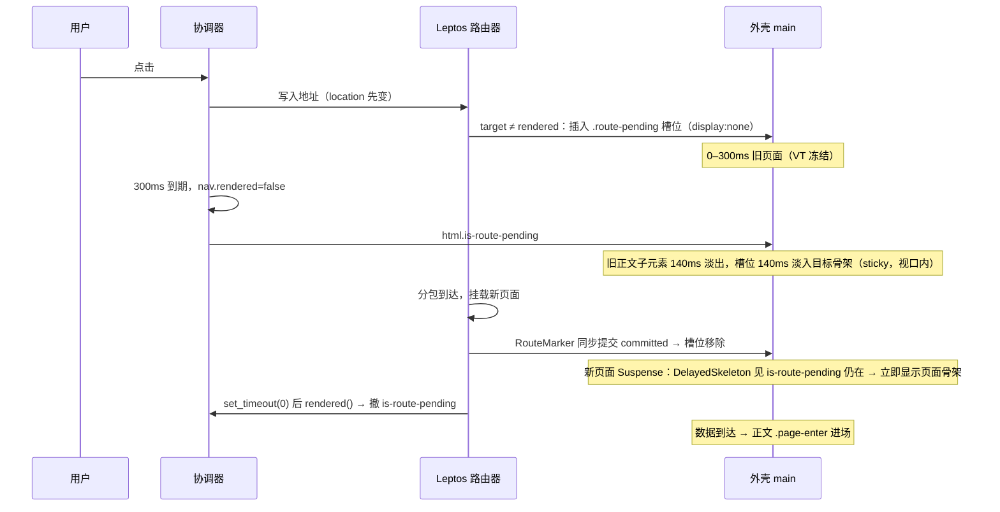

# 路由挂起骨架：分包迟到时显示目标页骨架，消除切页空白

## Context

`docs/plan/切页挂起淡出_PLAN.md` 已落地：目标页分包超过 300ms 未就绪时，协调器跳过空过渡、给 `<html>` 加 `is-route-pending`，旧正文淡出（`libs/yggdrasil-core/src/style.css:157`）。该计划在「否决方案」末行把「到期时显示目标页骨架屏」留作后续评估，本计划实现它。

现状（慢分包 + 慢数据，`scripts/test-view-transitions.cjs` 的 `delayWasm(page, 1200)` 即此场景）：

| 时间 | 画面 | 来源 |
|---|---|---|
| 0–300ms | 旧页面原样 | VT 冻结，`WAIT_MS`（`route-transitions.ts:15`） |
| 300–440ms | 旧正文淡出 | `defer()` → `is-route-pending` → `vt-fade-out 140ms` |
| 440ms – 分包到达 | **空白 1**：只剩页头页脚 + 顶部进度条 | 路由器保留旧出口，没有任何东西占位 |
| 分包到达 +0–200ms | **空白 2**：新页面已挂载，数据未到 | 页面 `Suspense` 的 `DelayedSkeleton` 从 0 重新计 200ms（`src/components/skeletons/delayed_skeleton.rs:12`） |
| 之后 | 页面骨架 → 正文 | |

为什么已有骨架接不住：

1. `FrontendLayout` 外层 `<Suspense fallback=route_skeleton(..)>`（`src/components/frontend_layout.rs:231`）与 `AdminLayout` 的 `<Suspense fallback=skeleton>`（`src/components/admin_layout.rs:571`）只在**已挂载的视图**读到未就绪资源时显示。懒加载分包未到时路由器不换视图（旧出口留着），这两个 fallback 不会出现。它们的注释（`frontend_layout.rs:168-170`、`admin_layout.rs:468-469,558,570`）声称“路由挂起时显示骨架”，与实际不符。
2. 页面自己的 `Suspense` 只在分包到达、页面挂载之后才存在，且统一套了 200ms 延迟。

终态：

- 到期（300ms）时旧正文淡出，**同一位置**淡入目标页的路由骨架，且骨架在视口内可见（旧页面已滚动到下方时也一样）。
- 分包到达、页面挂载后，页面的 `DelayedSkeleton` 若处于挂起尾声，**立即**显示，不再留 200ms 空白。
- 跨外壳（前台 ↔ 后台、登录）、目标未匹配、目标即当前页：保持现有整块 `main` 淡出。
- 300ms 门槛仍只在 `route-transitions.ts` 定义一次；Rust 只提供骨架内容，显隐由 CSS 跟随 `is-route-pending`。不改协调器 JS。

## 执行须知

- 开始前 `git status --short`；有不属于本计划的改动时不要混进提交。
- 不手改生成产物（`public/<lib>/`、`target/`）；`libs/yggdrasil-core/src/style.css` 改动后用 `make build-libs`（或 dev 时 `make dev-assets`，并按 AGENTS 记录手动同步 `target/site/yggdrasil-core`）。
- **水合必须与 SSR 一致**：新增的骨架槽位只在「地址栏路径 ≠ 已提交路径」时渲染，SSR 与水合首帧两者恒等，不会多出节点。不要用 `#[cfg(target_arch = "wasm32")]` 选择视图分支。
- `src/components` 下**不要新增 `pub fn PascalCase` 组件**（否则必须补 `components_showcase_data.json` 条目）。槽位直接内联在两个布局里，辅助函数用私有 `fn`。
- 不改 `route-transitions.ts`；不改 `WAIT_MS`；不改进度条。
- 分两次提交（见文末），每次提交前跑完对应验证。

## 时序



## 设计决定

| 问题 | 决定 | 理由 |
|---|---|---|
| 骨架何时进 DOM | `Show when = 地址栏 pathname ≠ use_rendered_route().pathname` 且目标属于本外壳 | 两个信号两个布局里都已有（`frontend_layout.rs:177,180`；`admin_layout.rs:475-479`）。SSR/水合时恒等，不影响水合。快速切换时槽位只在挂起的几个微任务内存在且 `display:none`，代价可忽略。 |
| 骨架何时可见 | 纯 CSS：`html.is-route-pending` 下才 `display:block` | 300ms 门槛只有协调器一份；Rust 不另起计时器（前一计划已否决“两套计时”）。 |
| 槽位放哪 | 最外层 `main` 的**第一个直接子元素** | 淡出规则要能区分“旧正文”和“骨架”；`erase_components` 下 `Show`/`Suspense` 不产生包裹元素，页面根元素就是 `main` 的直接子元素。 |
| 淡出对象 | 有槽位：`main > :not(.route-pending)`；无槽位：整块 `main`（原规则） | 骨架是 `main` 的后代，整块淡出会把骨架一起淡掉。用 `:has(> .route-pending)` 区分，项目已大量使用 `:has()`。登录页 `main.auth-panel`、跨外壳目标没有槽位，行为不变。 |
| 骨架在视口内 | 槽位 `position: sticky; height: 0; top: var(--route-pending-top)`，内容向下溢出盖在旧正文上 | 挂起期间协调器不滚动（`correctScroll` 只在 `rendered` 后执行），旧页面滚到下方时放在 `main` 顶部的骨架会在视口外。高度 0 的 sticky 不改变布局：未滚动时停在正文起点，滚动后贴在页头下方。 |
| 骨架溢出到页脚 | 挂起期间有槽位的 `main` 设 `overflow: clip` | 滚到页底时 sticky 槽位停在 `main` 底边，溢出部分会盖住页脚；`clip` 不创建滚动容器，不影响 sticky。 |
| 叠放 | 槽位 `z-index: 1`、`pointer-events: none` | 旧正文 opacity 动画会建立层叠上下文；骨架必须在上，且不可点（旧正文同样 `pointer-events: none`）。 |
| 骨架淡入 | `animation: vt-fade-in 140ms var(--ease-out-expo) both` | 与旧正文 140ms 淡出交叉，`vt-fade-in` 关键帧已存在（`style.css:162`）。 |
| 骨架种类 | 前台复用 `skeleton_kind` 映射、**不带** `DelayedSkeleton`；后台复用 `admin_route_skeleton(target_page)` | 已过 300ms，不需要再延迟；映射与布局 Suspense 兜底一致，有单测。 |
| 外壳归属 | 前台槽位只给 `route_prefetch::match_route` 判为前台页面的目标；后台槽位只给 `RouteTarget::Admin(_)` | 前台 → `/admin` 时 `skeleton_kind` 会落到 `Fallback`（首页骨架），画错。未匹配路径渲染同步的 `NotFound`，不会挂起。`match_route` 是路由表的镜像，两端都编译（`src/lib.rs:42`）。 |
| 空白 2 | `DelayedSkeleton` 的 Effect 若发现 `is-route-pending` 仍在，立即 `visible.set(true)` | 迟到页面挂载后，组件 Effect（微任务）先于 `RouteMarker` 的 `set_timeout(0)` → `rendered()` → `clearPending()`，此时类仍在。读 DOM 类不需要改 JS，也不需要缓存版本号以外的新接口。**这是本计划唯一的时序假设，浏览器回归必须断言它。** |
| `route_pending()` 放哪 | `src/bridges/navigation.rs`，与其余协调器封装同处；服务端恒 `false` | AGENTS：浏览器 API 只在桥接/Effect 内用 `cfg(wasm32)`。 |

## 改动

### 1. `libs/yggdrasil-core/src/style.css`

替换现有 `is-route-pending` 规则（`:155-160` 的注释与选择器），保留 `@keyframes vt-fade-out`/`vt-fade-in` 不动：

```css
/* 目标页分包超出 300ms 等待预算仍未就绪：协调器跳过空过渡并加 is-route-pending，
   新页面提交后撤销。只匹配最外层 main。
   外壳在 main 里放了 .route-pending（目标页骨架）时：旧正文淡出、骨架淡入并贴在视口顶部；
   没放（跨外壳、登录页、目标即当前页）时整块 main 淡出。 */
.route-pending {
  display: none;
}

html.is-route-pending main:not(main main):not(:has(> .route-pending)),
html.is-route-pending main:not(main main):has(> .route-pending) > :not(.route-pending) {
  animation: vt-fade-out 140ms var(--ease-out-expo) forwards;
  pointer-events: none;
}

/* 骨架向下溢出：滚到页底时不盖住页脚。clip 不建立滚动容器，sticky 仍相对视口。 */
html.is-route-pending main:not(main main):has(> .route-pending) {
  overflow: clip;
}

/* 高度为 0 的 sticky 槽位：不改变旧正文布局，内容盖在其上；
   未滚动时停在正文起点，滚动后贴在 --route-pending-top（由外壳设置）。 */
html.is-route-pending main:not(main main) > .route-pending {
  display: block;
  position: sticky;
  top: var(--route-pending-top, 0px);
  z-index: 1;
  flex: none;
  height: 0;
  pointer-events: none;
  animation: vt-fade-in 140ms var(--ease-out-expo) both;
}
```

- 不要加 `@media (prefers-reduced-motion)` 特例：与现有挂起淡出保持一致（人工验证见下）。
- Biome 若检查 CSS，按其格式修正。

### 2. `src/app.rs` `shell`

- `yggdrasil-core.css?v=4` → `?v=5`（以实施时当前值 +1 为准）。JS 未改，不动 `yggdrasil-core.js?v=`。

### 3. `styles/components/shell.css`

在 `.site-header` 规则附近加：

```css
  /* 路由挂起骨架贴在页头下方，与主区上内边距（py-6）一致。 */
  .site-route-pending {
    --route-pending-top: calc(var(--site-header-height) + 1.5rem);
  }
```

（按文件现有缩进/`@layer` 结构放置。）

### 4. `styles/components/admin.css`

在 `.admin-main-fill` 规则后加：

```css
  /* 路由挂起骨架贴在顶栏下方，与 .admin-main 上内边距一致；
     撑满可视高度，让写作页等 flex 填充型骨架有高度可分。 */
  .admin-route-pending {
    --route-pending-top: calc(var(--admin-topbar-h) + 0.5rem);
  }

  .admin-route-pending > * {
    min-height: calc(100dvh - var(--admin-topbar-h) - 0.5rem);
  }
```

`--admin-topbar-h` 定义在 `admin.css:12` 的外壳根上，槽位是其后代，可继承。

### 5. `src/bridges/navigation.rs`

在 `rendered()` 之后、`pub mod wasm` 之前加：

```rust
/// 协调器是否处于分包迟到的挂起状态（`<html>` 带 `is-route-pending`）。服务端恒为 `false`。
///
/// 迟到的新页面挂载后，组件 Effect（微任务）先于 `RouteMarker` 用 `set_timeout(0)`
/// 触发的 [`rendered`] 运行，协调器在 `rendered` 里才撤类，所以 Effect 内读到的仍为 `true`。
pub fn route_pending() -> bool {
    #[cfg(target_arch = "wasm32")]
    {
        leptos::prelude::document()
            .document_element()
            .is_some_and(|root| root.class_list().contains("is-route-pending"))
    }
    #[cfg(not(target_arch = "wasm32"))]
    {
        false
    }
}
```

`web-sys` 已启用 `Element`、`DomTokenList`（`Cargo.toml:105`）。若 `document()` 的导入路径与文件内现有写法不同，按现有写法。

### 6. `src/components/skeletons/delayed_skeleton.rs`

```rust
    Effect::new(move |_| {
        // 分包迟到的导航刚提交：用户已等过 300ms 并看着路由骨架，直接显示，不再留 200ms 空白。
        if crate::bridges::navigation::route_pending() {
            visible.set(true);
            return;
        }
        set_timeout(
            // …原样
        );
    });
```

同时更新文件头与组件文档注释：补一句“导航挂起（`is-route-pending`）期间挂载时立即显示”。SSR/水合首帧仍输出空内容（Effect 不在服务端运行），DOM 一致。

### 7. `src/components/frontend_layout.rs`

7.1 拆分骨架渲染：立即版供槽位用，延迟版供 Suspense 兜底用，映射不变。

```rust
use crate::route_prefetch::{match_route, RouteTarget};

/// 路径对应的骨架屏，立即渲染。
fn skeleton_view(path: &str) -> AnyView {
    match skeleton_kind(path) {
        SkeletonKind::Notes => view! { <NotesRouteSkeleton path=path.to_string()/> }.into_any(),
        SkeletonKind::HomePage(page) => view! { <HomeSkeleton current_page=page/> }.into_any(),
        SkeletonKind::Archives => view! { <ArchiveSkeleton/> }.into_any(),
        SkeletonKind::TagDetail(tag) => view! { <TagDetailSkeleton tag=tag/> }.into_any(),
        SkeletonKind::Friends => view! {
            <div class="friends">
                <FriendsSkeleton/>
            </div>
        }
        .into_any(),
        SkeletonKind::Search => view! { <SearchSkeleton/> }.into_any(),
        SkeletonKind::PostDetail => view! { <PostDetailSkeleton/> }.into_any(),
        SkeletonKind::Changelog => view! { <ChangelogSkeleton/> }.into_any(),
        SkeletonKind::WritingGuide => view! { <WritingGuideSkeleton/> }.into_any(),
        SkeletonKind::Showcase => {
            view! { <div class="py-20" role="status">"正在翻开组件图鉴…"</div> }.into_any()
        }
        SkeletonKind::Fallback => view! { <HomeSkeleton/> }.into_any(),
    }
}

/// 布局 Suspense 兜底：标签页与图鉴立即显示，其余延迟 200ms（见 `DelayedSkeleton`）。
fn route_skeleton(path: &str) -> AnyView {
    if matches!(skeleton_kind(path), SkeletonKind::TagDetail(_) | SkeletonKind::Showcase) {
        return skeleton_view(path);
    }
    let path = path.to_string();
    view! { <DelayedSkeleton>{move || skeleton_view(&path)}</DelayedSkeleton> }.into_any()
}

/// 懒加载分包挂起期间要占位的前台目标路径。
///
/// 地址栏已变、路由器仍显示旧页面时返回目标路径。目标不是前台页面（后台、登录、注册由别的
/// 外壳渲染；未匹配路径同步渲染 404，不会挂起）时返回 `None`，旧 `main` 整块淡出。
fn pending_target(target: &str, rendered: &str) -> Option<String> {
    if target == rendered {
        return None;
    }
    match match_route(target)? {
        RouteTarget::Login | RouteTarget::Register | RouteTarget::Admin(_) => None,
        _ => Some(target.to_string()),
    }
}
```

`route_skeleton` 的行为必须与改动前逐分支一致（哪些延迟、哪些不延迟、`Friends` 的 `.friends` 包裹）。若 `ChildrenFn` 不接受上面的闭包写法，改成 `<DelayedSkeleton>{skeleton_view(&path)}</DelayedSkeleton>` 并让宏生成 `ChildrenFn`（`path` 需能被 `Fn` 闭包重复借用）。

7.2 `FrontendLayout` 内：

```rust
    // 分包迟到时在 main 顶部占位目标页骨架；显隐由 CSS 跟随协调器的 is-route-pending。
    let pending = Memo::new(move |_| pending_target(&target_path.read(), &pathname.read()));
```

`main_content` 的 `view!` 最前面（`<Show when=move || !is_post.get()>` 之前）加：

```rust
                    <Show when=move || pending.read().is_some()>
                        <div class="route-pending site-route-pending" aria-hidden="true">
                            {move || pending.get().map(|path| skeleton_view(&path))}
                        </div>
                    </Show>
```

- `target_path` 是 `use_location().pathname`，`pathname` 是已提交路由的 `Memo<String>`，均已存在。
- 外层 `Suspense` 保留（兜底未被页面 Suspense 包住的资源读取），只改注释：

```rust
                    // 页面自己的 Suspense 先接住数据读取；这里兜底未被包住的资源读取。
                    // 懒加载分包未到时路由器保留旧页面、不会走到这里，由上方 .route-pending 占位。
```

- 更新 `FrontendLayout` 文档注释（`:167-173`）：去掉“在路由内容加载过程中显示与路由匹配的骨架屏”，改为分别说明“分包挂起时的 `.route-pending` 槽位”与“Suspense 兜底”。

7.3 单测（`mod tests` 内新增一个）：

```rust
    #[test]
    fn pending_target_only_covers_frontend_routes() {
        assert_eq!(pending_target("/archives", "/archives"), None);
        assert_eq!(pending_target("/archives", "/"), Some("/archives".to_string()));
        assert_eq!(pending_target("/post/hello", "/"), Some("/post/hello".to_string()));
        assert_eq!(pending_target("/admin", "/"), None);
        assert_eq!(pending_target("/admin/logs", "/"), None);
        assert_eq!(pending_target("/login", "/"), None);
        assert_eq!(pending_target("/register", "/"), None);
        assert_eq!(pending_target("/no/such/page", "/"), None);
    }
```

现有 `skeleton_kind_*` 与 `shell_*` 测试不改（`FrontendShell` 未动）。

### 8. `src/components/admin_layout.rs`

8.1 私有判定函数（文件内合适位置）：

```rust
/// 懒加载子路由挂起期间，目标是否为需要后台骨架占位的后台页面。
fn admin_pending(target: &str, rendered: &str) -> bool {
    target != rendered
        && matches!(
            crate::route_prefetch::match_route(target),
            Some(crate::route_prefetch::RouteTarget::Admin(_))
        )
}
```

注意本文件有自己的 `AdminPage`，与 `route_prefetch::AdminPage` 同名，用全路径或只导入 `RouteTarget`，不要导入 `route_prefetch::AdminPage`。

8.2 `AdminLayout` 内（`target_page` 定义之后）：

```rust
    let pending = Memo::new(move |_| admin_pending(&target_path.read(), &pathname.read()));
```

`content` 的 `signed_in` 分支改为：

```rust
                view! {
                    // 分包迟到时在 main 顶部占位目标页骨架；显隐由 CSS 跟随协调器的 is-route-pending。
                    <Show when=move || pending.get()>
                        <div class="route-pending admin-route-pending" aria-hidden="true">
                            {skeleton()}
                        </div>
                    </Show>
                    // 兜底子页面未被自身 Suspense 包住的资源读取；分包未到时由上方槽位占位。
                    <Suspense fallback=skeleton>
                        <Outlet/>
                    </Suspense>
                }
```

`skeleton()` 内部按 `target_page` 响应式选择，挂起中改道到另一个后台页面时自动换骨架。未登录分支不变。

8.3 修正注释：`:466-470` 文档注释、`:558`（“路由挂起或登录态校验期的页面骨架” → “登录态校验期与分包挂起槽位共用的页面骨架”）、`:570`（被 8.2 替换）。

8.4 单测：本文件若已有 `#[cfg(test)] mod tests`，加入；没有则新建：

```rust
    #[test]
    fn admin_pending_only_covers_admin_routes() {
        assert!(admin_pending("/admin/logs", "/admin"));
        assert!(!admin_pending("/admin", "/admin"));
        assert!(!admin_pending("/", "/admin"));
        assert!(!admin_pending("/login", "/admin"));
    }
```

## 边界

| 场景 | 预期 |
|---|---|
| 分包已缓存、快速切换（< 300ms） | 槽位在挂起微任务内插入又移除，始终 `display:none`；VT 正常，无可见变化。 |
| 分包已加载、接口慢 | 路由器立即挂新页，不进挂起；页面 `DelayedSkeleton` 照旧 200ms 延迟（类不存在）。 |
| 旧页面已滚到下方 | 槽位 sticky 贴在页头（后台：顶栏）下方 1.5rem（后台 0.5rem），骨架在视口内。 |
| 滚到页底再导航 | 槽位停在 `main` 底边，溢出部分被 `overflow: clip` 裁掉，页脚不被覆盖；可见区域可能只有一截骨架，可接受。 |
| 挂起中再点另一个慢页面 | `pending` 换成新目标，槽位内容随之换骨架；类保持。 |
| 挂起中后退到正在显示的页面 | `target == rendered`，槽位移除，规则切回整块 `main` 淡出；旧正文子元素的淡出动画撤销、`main` 重新从 1 淡出，可能有一次明暗晃动，随后新导航 `rendered` 撤类恢复。可接受；回归需断言不 panic、最终可见。 |
| 前台 → 后台 / 后台 → 前台 / → 登录 | 旧外壳无槽位（`pending_target`/`admin_pending` 为假），整块 `main` 淡出，与现状一致。 |
| 前台 → 文章页（桌面） | `main` 宽度跟随已显示页面（880px），文章骨架先按 880px 排，换页后变 1240px。`.post-layout` 全是 `minmax(0, …)`，不会溢出。已知取舍，不处理。 |
| `/about` | `skeleton_kind` 映射为 `Fallback`（首页骨架），与现有兜底一致；不在本计划扩充映射。 |
| 迟到页面挂载，数据已到（预取命中） | 槽位移除，正文 `.page-enter` 从 0 进场；与现状“空白 → 淡入”相同或更好。 |
| 迟到页面挂载，数据未到 | `DelayedSkeleton` 立即显示页面骨架，与槽位骨架衔接，无空白帧。 |
| 后台写作页等 `admin-main-fill` | 槽位是 flex 列中的 `flex: none; height: 0` 项，不挤压页面；骨架 `min-height` 撑满可视区。 |
| 未登录进后台 | `signed_in` 为假，走原有整页骨架分支，无槽位。 |
| 减少动态效果 | 与现有挂起淡出一致，不新增特例；人工确认骨架可见、无异常。 |

## 验证

### Rust

```sh
cargo test --locked components::frontend_layout
cargo test --locked components::admin_layout
cargo clippy --locked --all-targets -- -D warnings
cargo clippy --locked --target wasm32-unknown-unknown --no-default-features --features hydrate -- -D warnings
cargo fmt --check
```

### libs

```sh
make build-libs
cd libs && bun run --sequential --filter '*' test
```

（JS 未改，Vitest 应全部照旧通过；Biome 若覆盖 CSS，确保无告警。）

### 浏览器回归（`scripts/test-view-transitions.cjs`）

**必须先改断言**：`chunkLate` 现在采样的是 `main` 自身的 `opacity`（`:404-411,432`），改动后 `main` 不再淡出（子元素淡出），原断言 `frames[detail - 1].opacity <= 0.05` 会失效。

1. `chunkLate` 的每帧采样器改为记录：
   - `pending`：`is-route-pending`；
   - `old`：`main` 中**非** `.route-pending` 直接子元素的最大计算 `opacity`（没有则 `null`）；
   - `events`：上述子元素的 `pointer-events`（取第一个）；
   - `slot`：`main > .route-pending` 存在、计算 `display !== 'none'`、计算 `opacity`；
   - `skeletonInView`：`main .skeleton` 中是否有 `getClientRects().length > 0` 且与视口相交的元素；
   - `detail`：是否已有 `[data-vt-detail]`。
2. 断言（替换 `:432-433`，其余保留）：
   - 存在 `pending && slot.display && slot.opacity === 1 && skeletonInView` 的帧（路由骨架确实出现）；
   - 这些帧里 `old <= 0.05`（旧正文已淡出）；
   - 存在 `pending && events === 'none'` 的帧；
   - **无空白帧**：从第一个 `slot.opacity === 1` 的帧起，到第一个 `detail` 帧之前，每帧都满足 `skeletonInView`（覆盖空白 1 与空白 2；空白 2 若存在，说明 `DelayedSkeleton` 的时序假设不成立——见下方“失败时”）；
   - 结束后 `main > .route-pending` 不存在、`main` 与正文 `opacity` 为 1，其余原断言不变。
3. 新增 `chunkLateScrolled`（并入 `chunk` 模式）：`fresh` → `delayWasm(page, 1200)` → `window.scrollTo(0, document.documentElement.scrollHeight)` → `__routeTransitions.push('/changelog')` → 等 `is-route-pending` 后再等 200ms，断言 `main > .route-pending` 的 `getBoundingClientRect().top` 在 `[0, innerHeight / 2]` 且 `skeletonInView`；等 `main h1` 为更新日志标题、`settle` 后断言类已撤、无 `state.errors`。打印 `PASS chunk-late-skeleton-in-view`。
4. `chunkInterrupted`（`:447`）在恢复后（`:487` 附近）补断言：`main > .route-pending` 不存在。
5. 后台：在 `admin()` 登录后的流程末尾（或单独函数，复用其登录步骤，受 `VT_ADMIN_*` 环境变量控制）加一段：对某个尚未访问过的后台子页面分包（如 `/admin/logs` 对应的 `split___…logs…\.wasm`，以实际文件名为准）用 `page.route` 延迟 1200ms，`push` 过去，等 `is-route-pending` 后 200ms 断言 `main > .admin-route-pending` 可见且 `skeletonInView`；完成后断言类已撤。打印 `PASS admin-chunk-late-skeleton`。

```sh
make dev   # 另开终端
VT_BASE=http://localhost:8080 bun scripts/test-view-transitions.cjs chunk
VT_BASE=http://localhost:8080 bun scripts/test-view-transitions.cjs slow
VT_BASE=http://localhost:8080 VT_ADMIN_USERNAME=… VT_ADMIN_PASSWORD=… bun scripts/test-view-transitions.cjs admin
VT_BASE=http://localhost:8080 bun scripts/test-view-transitions.cjs all
```

`VT_BASE` 必须与 `APP_BASE_URL` 同源（本机设置为 `http://localhost:8080`；用 `127.0.0.1` 会 CSRF 403）。

**失败时**：若“无空白帧”断言在页面挂载后失败、且采样显示该段 `pending === false`，说明 `rendered()` 先于 `DelayedSkeleton` 的 Effect 撤了类。不要用定时器绕开；停下来报告采样结果，由人决定是否改协调器（例如在 JS 侧保留一个“上次导航迟到”的标记直到下一次导航开始）。

### 体积

`FrontendLayout` 与 `DelayedSkeleton` 在主包内：

```sh
make test-release-split
```

骨架组件此前已被 `route_skeleton` 引用，预期主包体积基本不变；超出门槛就报告，不要删功能凑数。

### 人工

`make dev`，DevTools 勾 Disable cache 并把网络限速到 Slow 4G，按 `scripts/README-view-transitions.md`：

- 首页 → 文章、首页 → 归档、首页 → 笔记、首页滚到底部 → 更新日志：300ms 后旧正文淡出、骨架淡入且在视口内，分包到达后无空白直接接上页面骨架或正文；
- 后台仪表盘 → 日志 / 写作 / 设置（冷分包）：骨架在顶栏下方，写作页骨架撑满；
- 前台 → 后台、后台 → 前台、→ 登录：仍是整块淡出，不出现错误外壳的骨架；
- 明暗主题、390px 移动端、键盘 Enter 触发、系统“减少动态效果”；
- 直接加载任意页面（水合）无控制台告警。

## 文档

- `scripts/README-view-transitions.md`：`chunk` 场景预期改为“旧正文淡出、目标页骨架在视口内淡入、分包到达后无空白衔接”，补 `chunk-late-skeleton-in-view` 与后台场景说明。
- `CHANGELOG.md` `[Unreleased]`（按现有分节）：**慢网络切页不再空白**：目标页分包加载超过 300ms 时，旧正文淡出后立即显示目标页骨架屏，页面挂载后骨架不再额外延迟。
- `docs/plan/切页挂起淡出_PLAN.md` 不改（历史记录）。

## 提交

1. 前台 + 公共部分（第 1、2、3、5、6、7 节，回归脚本前台部分，README，CHANGELOG）：`feat(navigation): 分包迟到时显示目标页骨架屏`
2. 后台（第 4、8 节，回归脚本后台部分）：`feat(admin): 子页面分包迟到时显示骨架屏`

## 否决方案

| 方案 | 原因 |
|---|---|
| Rust 用 `is_routing` + 300ms 计时决定骨架显隐 | 与协调器 `WAIT_MS` 两套计时，可能错一帧；VT 冻结期间显示也看不到。 |
| 挂起时把旧正文 `display:none`、骨架正常流内显示 | 页面高度骤变、页脚跳动；旧页面已滚动时还要改滚动位置，与协调器的滚动恢复冲突。 |
| 骨架 `position: fixed` | 要手算主区左右边界与宽度，前台三种宽度、后台侧栏可拖拽，易错。 |
| 槽位放在 `main` 外 | 无法继承主区宽度与内边距；后台还在内部滚动容器里。 |
| 挂起时让 `main` 宽度切到目标页宽度 | 需要 Rust 知道挂起状态或 CSS 写死每种宽度；只影响桌面端文章/图鉴首屏骨架，收益小。 |
| 去掉 `DelayedSkeleton` 的延迟 | 快速接口仍会闪骨架；只在挂起尾声跳过延迟即可。 |
| 删除布局外层 Suspense | 仍兜底页面外的资源读取，删除有回归风险，且不影响本问题。 |
