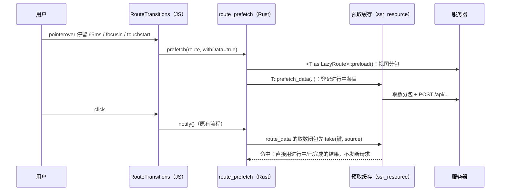

# 链接预取：悬停预取分包、页面数据与触屏视口预取

## Context

站内跳转由 `libs/yggdrasil-core/src/route-transitions.ts` 拦截点击后开启视图过渡，在 update 回调里通知 Rust，Leptos 路由器再执行 `Lazy::<T>::preload()`：先 `T::data()` 建资源（资源立即调用 `#[leptos::lazy]` 取数函数：先下载取数分包，再 `POST /api/<server fn>`），再下载并实例化视图分包。协调器最多等 300ms（`WAIT_MS`，`route-transitions.ts:15`），超时就用当时的 DOM 结束过渡，文章标题/封面的共享元素过渡随之丢失（`scripts/test-view-transitions.ts` 的 `slowResponse` 用例验证的就是这个超时行为）。

冷缓存时一次跳转要下载的量（`target/release-dist/public/pkg` + `__wasm_split_manifest`，brotli 字节；依赖 chunk 在路由间共享）：

| 路由 | 视图依赖 chunk | 依赖体积 | 视图自身 | 取数分包依赖 |
|---|---|---|---|---|
| `/post/:slug` | 387 | 263,999 | 19,860 | `fetch_post` 36 个 / 13,693 |
| `/`、`/page/:n` | 231 | 124,685 | 16,333 | `fetch_posts` 47 个 / 15,696 |
| `/notes/:slug` | 208 | 135,560 | 3,166 | — |
| `/archives` | 120 | 72,275 | 7,101 | `fetch_archive` 28 个 / 11,253 |
| `/tags/:tag` | 123 | 72,265 | 8,332 | — |

浏览器原生预取（Speculation Rules、`<link rel=prefetch>`）帮不上：SPA 跳转不请求 HTML，server fn 是 `POST` + JSON 不进 HTTP 缓存。可用的现成能力：

- `#[lazy_route]` 给每个路由生成静态 `async fn preload()`（`leptos_router_macro-0.8.7/src/lib.rs:301`），它走 `pkg/__wasm_split.*.js` 的 `makeLoad`：并发下载依赖、实例化并**记住成功结果**（失败不缓存，可重试）。`/pkg/` 带哈希文件是 `immutable`（`src/middleware.rs:177`）。悬停时调一次，点击时视图分包耗时为零。
- 公开页面的 server fn（`get_public_post_by_slug`、`get_note`、`list_notes`、`list_tags` 等）不读会话、没有副作用（全仓库无浏览计数）、服务端有 moka 缓存，重复调用代价低。

终态：鼠标悬停 / 键盘聚焦 / 触屏按下站内链接时预取目标路由的视图分包与页面数据；触屏设备空闲时预取视口内链接的分包。点击后命中预取，不重复请求；冷缓存下进文章页能在 300ms 内完成并保留共享元素过渡。

## 执行须知

- 三步依次做，每步验证后单独提交（`type(scope): 中文摘要`），只含本步改动。第 3 步可选，用户确认需要才做。
- 每步开始前 `git status --short`；工作树有不属于本计划的改动时不要混进提交。
- 不手改生成产物（`public/<lib>/`、`target/`）；JS 改动用 `make build-libs` 或 `make dev-assets` 重建。
- 浏览器 API 只能出现在 `#[cfg(target_arch = "wasm32")]` 或 `#[cfg(feature = "hydrate")]` 代码里，且不能改变视图分支（水合必须与 SSR 一致）。本计划不改任何视图。
- WASM 端不能用 `std::time::Instant`（wasm32-unknown-unknown 上会 panic），时间一律用 `js_sys::Date::now()`。
- 从 JS 回调进入 Rust 后读取信号用 `try_with_untracked`，避免在信号已释放时 panic（wasm 里只显示 `unreachable`）。
- 每步都要跑：
  ```sh
  cargo fmt --check
  cargo clippy --locked --all-targets -- -D warnings
  cargo clippy --locked --target wasm32-unknown-unknown --no-default-features --features hydrate -- -D warnings
  cargo test --locked
  cd libs && bun run biome check . && bun run typecheck && bun run --sequential --filter '*' test
  ```

## 总体设计



---

## 第 1 步：悬停预取路由分包 — `feat(navigation): 悬停预取路由分包`

### 1.1 JS 协调器（`libs/yggdrasil-core/src/route-transitions.ts`）

1. 新常量（放在 `WAIT_MS` 附近）：
   ```ts
   /** 鼠标停留多久算“有意点击”（instant.page 的默认值）。 */
   const HOVER_INTENT_MS = 65;
   /** 同一地址两次预取的最小间隔，挡住指针抖动；数据新鲜度由 Rust 缓存自己判断。 */
   const PREFETCH_THROTTLE_MS = 2000;
   ```
2. 抽出链接判定，`onClick` 与预取共用，`onClick` 行为保持不变：
   ```ts
   /** 站内 SPA 链接 → 去掉前缀的“路径 + 查询 + 哈希”；不该由协调器接管的返回 undefined。 */
   private routableAnchor(target: EventTarget | null): { anchor: HTMLAnchorElement; url: string } | undefined
   ```
   判定条件原样搬自现在的 `onClick`（`route-transitions.ts:298-308`）：`closest('a[href]')`、`target` 为空或 `_self`、无 `download`、`rel` 不含 `external`、同源、路径不以 `NATIVE_PREFIXES` 开头。`url = anchor.pathname.slice(this.prefix.length) + anchor.search + anchor.hash`。`onClick` 改为调用它，按钮/修饰键/`defaultPrevented` 检查仍留在 `onClick`。
3. 网络受限判断（模块级函数）。TS 的 DOM lib 没有 `navigator.connection`，用局部类型：
   ```ts
   function constrainedNetwork(): boolean {
     const connection = (navigator as Navigator & {
       connection?: { saveData?: boolean; effectiveType?: string };
     }).connection;
     return connection?.saveData === true || /2g$/.test(connection?.effectiveType ?? '');
   }
   ```
4. 新字段：
   ```ts
   private prefetch: ((route: string, withData: boolean) => void) | undefined;
   private prefetched = new Map<string, number>(); // 预取地址（不含哈希）→ 上次时间
   private intentTimer: number | undefined;
   private intentAnchor: HTMLAnchorElement | undefined;
   ```
5. `connect(notify, prefix, prefetch?: (route: string, withData: boolean) => void)`：第三个参数可选，现有测试 `routes.connect(notify, null)` 不用改。已连接时的分支（`if (this.notify) { this.notify = notify; return; }`）同样更新 `this.prefetch`。首次连接时注册：
   ```ts
   document.addEventListener('pointerover', this.onPointerOver, { passive: true });
   document.addEventListener('pointerout', this.onPointerOut, { passive: true });
   document.addEventListener('focusin', this.onFocusIn);
   document.addEventListener('focusout', this.onPointerOut);
   document.addEventListener('touchstart', this.onTouchStart, { capture: true, passive: true });
   ```
   `disconnect()` 用同样的 `capture` 取值移除这些监听，`clearTimeout(this.intentTimer)`，清空 `prefetch`、`prefetched`、`intentAnchor`。
6. 处理器：
   - `onPointerOver(event: PointerEvent)`：`pointerType` 不是 `mouse` 或 `pen` 时直接返回（触屏交给 `touchstart`）。`routableAnchor(event.target)` 为空，或锚点就是 `intentAnchor`（同一链接的子元素会反复触发 pointerover），直接返回。否则清掉旧定时器，记下 `intentAnchor`，`setTimeout(HOVER_INTENT_MS)` 到期调用 `this.requestPrefetch(url, true)`。
   - `onPointerOut(event: PointerEvent | FocusEvent)`：`relatedTarget` 仍在 `intentAnchor` 内时返回；否则清定时器、清 `intentAnchor`。
   - `onFocusIn(event: FocusEvent)`：键盘聚焦，与 pointerover 相同的延时逻辑（Tab 连续扫过多个链接时不会每个都预取）。
   - `onTouchStart(event: TouchEvent)`：立即 `requestPrefetch(url, true)`（按下到抬起约 100ms，就是用这段时间）。
   - `onClick` 在 `event.preventDefault()` 前清掉 `intentTimer`、`intentAnchor`：点击已经开始导航，不能等到点击后才预取（否则资源已发出请求，预取条目没人消费）。
7. `requestPrefetch(url: string, withData: boolean)`：
   ```ts
   if (!this.prefetch || !this.active || constrainedNetwork()) return;
   const target = page(url);
   if (target === page(this.displayed)) return; // 当前页（含页内锚点）不预取
   const now = performance.now();
   if (now - (this.prefetched.get(target) ?? -Infinity) < PREFETCH_THROTTLE_MS) return;
   if (this.prefetched.size > 200) this.prefetched.clear();
   this.prefetched.set(target, now);
   try {
     this.prefetch(target, withData);
   } catch {
     // 预取失败不能影响导航；Rust 回调出错时这里吞掉。
   }
   ```
   传给 Rust 的是去掉前缀、去掉哈希的“路径 + 查询”。

### 1.2 Rust 桥接（`src/bridges/navigation.rs`）

- extern `connect` 加第三个参数：
  ```rust
  #[wasm_bindgen(method, catch)]
  pub fn connect(
      this: &NavigationModule,
      notify: &Closure<dyn FnMut()>,
      prefix: Option<&str>,
      prefetch: &Closure<dyn FnMut(String, bool)>,
  ) -> Result<(), JsValue>;
  ```
- 封装 `pub fn connect(notify: &Closure<dyn FnMut()>, prefetch: &Closure<dyn FnMut(String, bool)>) -> bool`，同步更新文档注释：JS 同时持有两个闭包，调用方要让两者活到 `disconnect` 之后。

### 1.3 路由匹配（新文件 `src/route_prefetch.rs`，`src/lib.rs` 加 `pub mod route_prefetch;`，放在 `routes` 后面）

模块文档写清：这份匹配表与 `src/app.rs` 路由表一一对应，**新增路由时两处一起改**；漏改只会少一次预取，不影响导航。在 `src/app.rs` 路由表上方加一行注释指向这里。

1. 纯函数部分（native/wasm 都编译，便于单元测试）：
   ```rust
   /// 悬停目标。参数是路由器会看到的值：路径段经 `Url::unescape` 解码，查询值同样解码。
   #[derive(Debug, Clone, PartialEq, Eq)]
   pub enum RouteTarget {
       Home { page: Option<String> },        // "/" → None；"/page/:page" → Some(原始段)
       Notes,
       Notebook { id: String },
       Note { slug: String, book: Option<String> }, // book 来自 ?book=
       Archives,
       Tag { tag: String },
       Post { slug: String },
       Search,
       About,
       WritingGuide,
       Showcase,
       ShowcaseDetail,
       Friends,
       Changelog,
       Login,
       Register,
       Admin(AdminPage),
   }

   #[derive(Debug, Clone, Copy, PartialEq, Eq)]
   pub enum AdminPage {
       Dashboard, Write, WriteEdit, Preview, Posts, PostsTrash, Notes, NewNote, EditNote,
       Notebooks, Assets, Friends, Comments, System, Runner, Mcp, Logs, Settings, Profile,
   }

   /// `route` 为“路径 + 可选查询”（无前缀、无哈希）。不匹配任何页面返回 `None`。
   pub fn match_route(route: &str) -> Option<RouteTarget>
   ```
   规则：
   - 按 `?` 切开路径与查询；路径必须以 `/` 开头；去掉开头的 `/` 后按 `/` 切段，**任何段为空即不匹配**（覆盖尾斜杠与 `//`，`/` 本身例外）。
   - 段与 `app.rs` 一一对应：`[]`→Home、`["page", p]`→Home、`["notes"]`、`["notes","book",id]`（必须先于 `["notes", slug]`）、`["notes", slug]`、`["archives"]`、`["tags", t]`、`["post", s]`、`["search"]`、`["about"]`、`["about","writing"]`、`["about","components"]`、`["about","components", _]`、`["friends"]`、`["changelog"]`、`["login"]`、`["register"]`；`["admin", ..]` 按 `app.rs:198-221` 的子路由映射到 `AdminPage`（`comments` 与 `comments/:page` 都是 `Comments`）。
   - 参数段用 `leptos_router::location::Url::unescape` 解码（路由器的 `ParamsMap::insert` 也是这么做的，`leptos_router-0.8.17/src/params.rs:29`）。
   - 查询解析写个私有函数 `query_value(search, key) -> Option<String>`：按 `&` 切，`split_once('=')`，键、值都用 `Url::unescape`，取第一个匹配的。
2. 分发部分：
   ```rust
   /// 预取目标路由：总是预取视图分包；`with_data` 时再预取页面数据（第 2 步接入）。
   /// `is_admin` 为假时跳过 `/admin*`：访客悬停后台链接不下载后台分包。
   pub fn prefetch(route: &str, with_data: bool, is_admin: bool)
   ```
   - 非 wasm：`let _ = (route, with_data, is_admin);` 空操作。
   - wasm：`match_route` 后对每个目标 `leptos::task::spawn_local(<X as LazyRoute>::preload())`（需要 `use leptos_router::LazyRoute;`）。路由类型从 `app.rs` 已有的 `use` 路径引入。对应关系：Home→`HomeRoute`、Notes→`NotesRoute`、Notebook→`NotebookRoute`、Note→`NoteRoute`、Archives→`ArchivesRoute`、Tag→`TagRoute`、Post→`PostRoute`、Search→`SearchRoute`、About→`AboutRoute`、WritingGuide→`WritingGuideRoute`、Showcase→`ShowcaseRoute`、ShowcaseDetail→`ShowcaseDetailRoute`、Friends→`FriendsRoute`、Changelog→`ChangelogRoute`、Login→`LoginRoute`、Register→`RegisterRoute`；`Admin(page)` 先 `AdminShellRoute::preload()`，再预取对应子路由（`Dashboard`→`DashboardRoute` … `Profile`→`ProfileRoute`，见 `app.rs:199-221`）。
   - 本步 `with_data` 不使用（写 `let _ = with_data;`），第 2 步接入。

### 1.4 `NavigationBridge`（`src/navigation.rs:103-133`）

- 组件开头取 `let user = use_context::<UserContext>();`（`crate::context::UserContext`）。
- 再建一个闭包，与 `notify` 一样存进 `StoredValue::new_local`，在同一个 `Effect` 里一起传给 `bridges::navigation::connect`：
  ```rust
  let prefetch = Closure::wrap(Box::new(move |route: String, with_data: bool| {
      let is_admin = user.is_some_and(|ctx| {
          ctx.user
              .try_with_untracked(|u| u.as_ref().is_some_and(|u| u.role == UserRole::Admin))
              .unwrap_or(false)
      });
      crate::route_prefetch::prefetch(&route, with_data, is_admin);
  }) as Box<dyn FnMut(String, bool)>);
  ```
- 模块文档（`navigation.rs:1-15`）加一条：`NavigationBridge` 同时把悬停预取回调交给协调器，见 `route_prefetch`。

### 1.5 资源版本与 CHANGELOG

- `src/app.rs:71` 的 `yggdrasil-core.js?v=5` 改为 `?v=6`（脚本内容变了）。
- `CHANGELOG.md` `## [Unreleased]` 下的 `### Added` 加一条：`- **链接悬停预取**：鼠标停留、键盘聚焦或触屏按下站内链接时提前下载目标页面的 WASM 分包，点击后不再等分包下载；省流量模式与 2G 网络下不预取。`（第 2、3 步各自改写这一条，不另起新条目。）

### 1.6 测试

- `src/route_prefetch.rs` 内 `#[cfg(test)] mod tests`，用断言表覆盖：
  - `/notes/book/3` 匹配 `Notebook`，不是 `Note { slug: "book" }`；`/notes/book` 匹配 `Note { slug: "book" }`（与路由器一致：三段才是笔记本）。
  - `/tags/%E4%B8%AD%E6%96%87` 得到 `Tag { tag: "中文" }`；`/post/a%20b` 得到 `slug: "a b"`。
  - `/notes/x?book=7&book=8` 取第一个 `book`；没有查询时为 `None`。
  - `/admin`→`Admin(Dashboard)`、`/admin/comments/2`→`Admin(Comments)`、`/admin/write/5`→`Admin(WriteEdit)`。
  - 不匹配：`/post/`、`/post`、`/post/a/b`、`//`、`/unknown`、`/api/x`、空串、不以 `/` 开头的串。
- `libs/yggdrasil-core/src/route-transitions.test.ts` 新 `describe('link prefetch')`。`connect` 时传第三个参数 `prefetch = vi.fn()`（本 describe 内先 `routes.disconnect()` 再 `routes.connect(notify, null, prefetch)`）。用例：
  - 鼠标悬停（`new PointerEvent('pointerover', { bubbles: true, pointerType: 'mouse' })`；happy-dom 没有 `PointerEvent` 时用 `MouseEvent` 再 `Object.defineProperty(event, 'pointerType', { value: 'mouse' })`）在 64ms 时还没调用，65ms 时以 `('/post/a', true)` 调用一次；
  - 定时器到期前 `pointerout` 到链接外（`relatedTarget` 为 `document.body`）则不调用；`relatedTarget` 是链接内子元素时仍然调用；
  - 悬停后立即点击：不调用 `prefetch`，导航照常发起；
  - `touchstart` 立即调用；`pointerType: 'touch'` 的 pointerover 不调用；
  - `rel="external"`、`/api/x`、跨域、当前页（`/#h` 而当前是 `/`）都不调用；
  - 2 秒内同一地址只调用一次，超过 2 秒再次调用；哈希不同的同一页面视为同一地址；
  - `navigator.connection = { saveData: true }`（`vi.stubGlobal` 或 `Object.defineProperty(navigator, 'connection', …)`，测试后还原）时不调用；
  - `prefetch` 抛错时不冒出异常，随后点击导航仍正常；
  - `disconnect()` 后再悬停不调用。

### 1.7 验证

- 跑「执行须知」里的全部检查。
- `scripts/test-view-transitions.ts` 新增模式 `prefetch`（加到文件末尾的模式分发里，`all` 也包含它）：
  ```js
  async function prefetch() {
    const state = await launch();
    const { page, browser } = state;
    try {
      await fresh(state);
      const link = page.locator('a[data-vt-post-link]').first();
      await link.evaluate(e => e.scrollIntoView({ block: 'center', behavior: 'instant' }));
      const chunk = page.waitForResponse(r => /split___post_route_view_.*\.wasm/.test(r.url()));
      await link.hover();
      await chunk; // 悬停即下载文章视图分包
      // 第 2 步在此补充数据预取断言
      await link.click();
      await page.waitForSelector('[data-vt-detail]');
      assert.deepEqual(state.errors, []);
      console.log('PASS hover-prefetch-chunk');
    } finally { await browser.close(); }
  }
  ```
  另起一个 shell 跑 `make dev`（`APP_BASE_URL` 必须与 `VT_BASE` 同源），然后 `VT_BASE=http://127.0.0.1:<端口> bun scripts/test-view-transitions.ts prefetch`，再跑一遍 `public`、`slow`、`mobile`，确认原有用例不受影响（`slow` 依赖“点击时不触发预取”）。
- 手动冒烟：Chromium DevTools Network 勾 Disable cache + Fast 4G，在首页悬停文章卡片，确认点击前已出现 `split___post_route_view_*.wasm` 和它的 `chunk_*.wasm`；勾 DevTools 的 Save-Data 模拟（或 `navigator.connection` 不可用时跳过）时不出现。

---

## 第 2 步：悬停预取页面数据 — `feat(navigation): 悬停预取页面数据`

### 2.1 预取缓存（`src/hooks/ssr_resource.rs`）

**缓存键**：`TypeId::of::<F>()`，其中 `F` 是 `route_data` 的取数函数类型，再加上 source 的值（用 `Box<dyn Any + Send>` 存，`downcast_ref::<S>()` 后比较 `PartialEq`）。具名函数项、`unit(f)` 返回的闭包的类型都是唯一的，数据页 `data()` 和预取两边传同一个函数就是同一个键；闭包字面量每处类型都不同，**永远不会命中**，只是不预取，不会取错数据。在 `route_data` 的文档里写明这条约定。

1. 新增无参取数函数适配器（所有目标都编译）：
   ```rust
   /// 把无参取数函数包成 `Fn(())`，与 `route_data(|| (), unit(f))` 搭配。
   /// 返回的闭包类型只取决于 `f` 的函数项类型，`data()` 与悬停预取得到同一个预取键。
   pub fn unit<F, Fut>(fetcher: F) -> impl Fn(()) -> Fut + Send + Sync + Copy + 'static
   where
       F: Fn() -> Fut + Send + Sync + Copy + 'static,
   {
       move |()| fetcher()
   }
   ```
2. 存储结构放进 `#[cfg(any(target_arch = "wasm32", test))] mod prefetch { … }`，只用 std（`futures` 只有 server feature 才有）：
   ```rust
   pub(super) const TTL_MS: f64 = 10_000.0; // 完成后保留多久
   pub(super) const CAPACITY: usize = 24;

   enum Slot { Pending(Vec<Waker>), Ready(RawJson) }

   struct Entry {
       id: u64,
       fetcher: TypeId,
       source: Box<dyn Any + Send>,
       done_at: Option<f64>, // None = 进行中
       slot: Arc<Mutex<Slot>>,
   }

   pub(super) struct Store { inner: Mutex<(u64, Vec<Entry>)> } // (下一个 id, 条目)

   impl Store {
       pub(super) const fn new() -> Self;
       /// 已有同键的进行中条目或未过期的已完成条目时返回 None（不重复请求）；
       /// 否则清理过期条目、超出容量时淘汰最早的已完成条目（没有就淘汰最早的条目），
       /// 登记进行中条目并返回 id。
       pub(super) fn begin<S: PartialEq + Send + 'static>(&self, fetcher: TypeId, source: S, now: f64) -> Option<u64>;
       /// 写入结果并唤醒全部等待者。结果是错误（`is_err_json`）时从列表删掉条目：
       /// 已经在等的消费者照样拿到这次结果，之后的导航重新请求。
       pub(super) fn complete(&self, id: u64, raw: RawJson, now: f64);
       /// 取走同键条目（一次性）：进行中的直接加入等待；已完成且超过 TTL 的删掉并返回 None。
       pub(super) fn take<S: PartialEq + 'static>(&self, fetcher: TypeId, source: &S, now: f64) -> Option<Prefetched>;
   }

   /// 预取结果的等待句柄。`Arc<Mutex<_>>` 内容都是 Send，满足 `Resource` 对 future 的 `Send` 约束。
   pub(super) struct Prefetched(Arc<Mutex<Slot>>);
   impl Future for Prefetched {
       type Output = RawJson;
       // Ready → Poll::Ready(raw.clone())；Pending → 若没有 will_wake 的同一 waker 就追加，返回 Pending。
   }
   ```
   进行中的条目不按 TTL 过期（慢网络下仍在途的请求照样可以等）；TTL 从完成时刻算。
3. 错误判定不反序列化具体类型，用编码格式：`PageJson::new` 用 `serde_json::to_string(&Result<T, ServerFnError>)`，外部标签格式，错误一定以 `{"Err"` 开头：
   ```rust
   fn is_err_json(raw: &RawJson) -> bool { raw.0.starts_with("{\"Err\"") }
   ```
   用单元测试固定这条不变量（见 2.5）。
4. 仅 wasm：
   ```rust
   #[cfg(target_arch = "wasm32")]
   static PREFETCH: prefetch::Store = prefetch::Store::new();
   #[cfg(target_arch = "wasm32")]
   fn now_ms() -> f64 { js_sys::Date::now() }
   ```
5. 公开的预取入口（所有目标都编译；非 wasm 是空操作，服务端不会有跨请求的全局状态）：
   ```rust
   /// 悬停预取一份路由数据：键与 [`route_data`] 相同（`fetcher` 的类型 + `source`）。
   /// 之后导航到该页时 `route_data` 直接复用结果。只用于不依赖会话的公开数据。
   pub fn prefetch_route_data<S, T, F, Fut>(source: S, fetcher: F)
   where
       S: PartialEq + Clone + Send + 'static,
       F: Fn(S) -> Fut + 'static,
       Fut: Future<Output = PageJson<T>> + Send + 'static,
   {
       #[cfg(target_arch = "wasm32")]
       {
           let Some(id) = PREFETCH.begin(TypeId::of::<F>(), source.clone(), now_ms()) else {
               return;
           };
           let fut = fetcher(source);
           leptos::task::spawn_local(async move {
               let raw = fut.await.raw;
               PREFETCH.complete(id, raw, now_ms());
           });
       }
       #[cfg(not(target_arch = "wasm32"))]
       let _ = (source, fetcher);
   }
   ```
6. `route_data` 改为具名泛型 `F`，取数闭包在 wasm 上先查缓存。**不要装箱**：用一个 async 块二选一等待；非 wasm 分支保持原样：
   ```rust
   pub fn route_data<S, T, F, Fut>(
       source: impl Fn() -> S + Send + Sync + 'static,
       fetcher: F,
   ) -> RouteData<T>
   where
       S: PartialEq + Clone + Send + Sync + 'static,
       F: Fn(S) -> Fut + Send + Sync + 'static,
       Fut: Future<Output = PageJson<T>> + Send + 'static,
   {
       let raw = Resource::new_with_options(
           source,
           move |source| {
               #[cfg(target_arch = "wasm32")]
               {
                   let pending = match PREFETCH.take(TypeId::of::<F>(), &source, now_ms()) {
                       Some(hit) => Ok(hit),
                       None => Err(fetcher(source)),
                   };
                   async move {
                       match pending {
                           Ok(hit) => hit.await,
                           Err(fut) => fut.await.raw,
                       }
                   }
               }
               #[cfg(not(target_arch = "wasm32"))]
               {
                   let fut = fetcher(source);
                   async move { fut.await.raw }
               }
           },
           false,
       );
       …
   }
   ```
   水合时资源直接用 SSR 序列化的值、不调用取数闭包，所以首屏不受影响。
7. 更新模块文档（`ssr_resource.rs:1-25`）：加一节「悬停预取」，说明键约定、`unit`、`prefetch_route_data`、TTL/一次性/出错不缓存。

### 2.2 让公开路由的取数函数可作键

范围：所有用 `route_data` 的公开前台路由，**除了**组件图鉴（`fetch_showcase` 在客户端已有 `CLIENT_SHOWCASE` 缓存）。每个路由的每一处 `route_data` 都要改成可作键的形式，否则那一份数据仍然要现场请求，Suspense 照样等它。

| 文件 | 原写法 | 改为 |
|---|---|---|
| `pages/archives.rs:109-110` | `route_data(\|\| (), \|_\| fetch_archive())`、`\|_\| fetch_tags()` | `route_data(\|\| (), unit(fetch_archive))`、`unit(fetch_tags)` |
| `pages/about.rs:50-52` | 三处 `\|_\| fetch_x()` | `unit(fetch_years)`、`unit(fetch_tags)`、`unit(fetch_release)` |
| `pages/tags.rs:39-40` | `fetch_tag_posts`（已是函数项）、`\|_\| fetch_tags()` | 保留 `fetch_tag_posts`；`unit(fetch_tags)` |
| `pages/post_detail.rs:57` | `fetch_post` | 不变 |
| `pages/home.rs:112-116` | 全部已是函数项 | 不变 |
| `pages/notes.rs:162-164`（`NotesRoute`） | `\|_\| fetch_notebooks()`、`\|_\| fetch_note_stats()`、`\|_\| fetch_note_page(first_filter())` | `unit(fetch_notebooks)`、`unit(fetch_note_stats)`、`unit(first_note_page)`；新增 `fn first_note_page() -> impl Future<Output = PageJson<NotePage>> + Send + 'static { fetch_note_page(first_filter()) }` |
| `pages/notes.rs:863-873`（`NotebookRoute`） | `\|_\| fetch_notebooks()`（source 为 id）、`\|id\| fetch_note_page(NoteFilter{..})` | 新增具名函数 `fn notebook_books(_id: Option<i32>) -> impl Future<…> + Send + 'static { fetch_notebooks() }`、`fn notebook_notes(id: Option<i32>) -> impl Future<…> + Send + 'static { fetch_note_page(NoteFilter { notebook_id: id, page: 1, ..Default::default() }) }`，source 不变 |
| `pages/notes.rs:1231-1235`（`NoteRoute`） | `fetch_note`、`\|(slug, book)\| fetch_note_context(slug, book)` | 保留 `fetch_note`；新增 `fn note_context((slug, book): (String, Option<i32>)) -> impl Future<…> + Send + 'static { fetch_note_context(slug, book) }` |
| `pages/friends.rs:38-39` | `\|_\| fetch_links()`、`\|_\| fetch_card()` | `unit(fetch_links)`、`unit(fetch_card)` |
| `pages/changelog.rs:42` | `\|_\| fetch_changelog()` | `unit(fetch_changelog)` |
| `pages/writing_guide.rs:73` | `\|_\| fetch_guide()` | `unit(fetch_guide)` |

`impl Future<…>` 处写全输出类型，例如 `impl Future<Output = PageJson<Vec<Notebook>>> + Send + 'static`。这些包装函数是普通函数（不加 `#[leptos::lazy]`），只转调懒加载函数，留在主包，体积可忽略。

### 2.3 每个路由的 `prefetch_data`

在各页面模块的 `impl LazyRoute for X` 旁边加一个固有 impl，参数是 `route_prefetch` 解码后的原始字符串，解析逻辑与 `data()` **共用同一个辅助函数**（从 `data()` 里抽出来，`data()` 改为调用它），保证两边算出的 source 相同：

```rust
impl PostRoute {
    /// 悬停预取：与 `data()` 相同的取数函数与 source。
    pub fn prefetch_data(slug: String) {
        prefetch_route_data(slug, fetch_post);
    }
}
```

| 路由 | 签名 | 内容 |
|---|---|---|
| `HomeRoute`（`home.rs`） | `pub fn prefetch_data(page: Option<&str>)` | 抽出 `fn page_param(raw: Option<&str>) -> Option<i32>`（`None`→`Some(1)`，否则 `parse::<i32>().ok().map(\|p\| p.max(1))`），`data()` 的 `page` Memo 改为 `page_param(params.read().get("page").as_deref())`。预取：`let page = page_param(raw); let first = page == Some(1);` 然后 `prefetch_route_data(page.unwrap_or(1), fetch_posts)` 以及 `fetch_home_tags`、`fetch_settings`、`fetch_outline`、`fetch_notes` 各以 `first` 为 source |
| `NotesRoute` | `pub fn prefetch_data()` | `unit(fetch_notebooks)`、`unit(fetch_note_stats)`、`unit(first_note_page)`，source 都是 `()` |
| `NotebookRoute` | `pub fn prefetch_data(id: &str)` | 抽出 `fn notebook_id(raw: Option<&str>) -> Option<i32>`（`and_then(parse::<i32>().ok())`），`data()` 共用；`notebook_books`、`notebook_notes` 以该值为 source |
| `NoteRoute` | `pub fn prefetch_data(slug: String, book: Option<&str>)` | 抽出 `fn book_param(raw: Option<&str>) -> Option<i32>`，`data()` 共用；`prefetch_route_data(slug.clone(), fetch_note)`、`prefetch_route_data((slug, book_param(book)), note_context)` |
| `ArchivesRoute` | `pub fn prefetch_data()` | `unit(fetch_archive)`、`unit(fetch_tags)` |
| `TagRoute` | `pub fn prefetch_data(tag: String)` | `fetch_tag_posts`（source `tag`）、`unit(fetch_tags)` |
| `PostRoute` | `pub fn prefetch_data(slug: String)` | `fetch_post` |
| `AboutRoute` | `pub fn prefetch_data()` | `unit(fetch_years)`、`unit(fetch_tags)`、`unit(fetch_release)` |
| `FriendsRoute` | `pub fn prefetch_data()` | `unit(fetch_links)`、`unit(fetch_card)` |
| `ChangelogRoute` | `pub fn prefetch_data()` | `unit(fetch_changelog)` |
| `WritingGuideRoute` | `pub fn prefetch_data()` | `unit(fetch_guide)` |

注意 `Url::unescape` 之后 `slug`、`tag` 就是 `params.get(..)` 会得到的值，`data()` 里的 `unwrap_or_default()` 只在参数缺失时生效，匹配函数已保证参数段非空，两边一致。

### 2.4 接入分发（`src/route_prefetch.rs`）

`prefetch` 的 wasm 分支在预取视图分包之后，`with_data` 为真时调用对应的 `X::prefetch_data(..)`。不预取数据的路由：`Search`（无路由数据）、`Showcase`/`ShowcaseDetail`（客户端已有缓存）、`Login`/`Register`、全部 `Admin(..)`（后台数据依赖会话且常被写操作改动）。去掉第 1 步的 `let _ = with_data;`。

### 2.5 测试（`src/hooks/ssr_resource.rs` 已有的 `mod tests`）

`Store` 的测试直接新建实例，不碰全局 `PREFETCH`；时间作为参数传入；手动 poll 用 `std::task::Waker::noop()`。

- 键：`fn key_of<F: 'static>(_: &F) -> TypeId { TypeId::of::<F>() }`；`key_of(&unit(a)) == key_of(&unit(a))`；`key_of(&unit(a)) != key_of(&unit(b))`（`a`、`b` 是两个签名相同的测试函数）。
- `begin` 去重：同键进行中再 `begin` 返回 `None`；source 不同返回 `Some`；不同 `TypeId` 但 source 相同返回 `Some`。
- 进行中被 `take`：先 poll 得 `Pending`；`complete` 后 poll 得到同一份 `RawJson`。
- 一次性：`take` 之后再 `take` 同键返回 `None`。
- TTL：`complete(t)` 后在 `t + TTL_MS - 1` 能 `take`；另一条在 `t + TTL_MS + 1` 不能 `take`，且同键可以重新 `begin`。进行中条目在 `begin` 之后很久（大于 TTL）仍能 `take`。
- 出错不缓存：`complete` 一个 `{"Err":…}` 结果后同键 `take` 返回 `None`；完成前已拿到的等待句柄仍得到这份错误结果。
- 容量：登记 `CAPACITY + 1` 个已完成条目后，最早的那个被淘汰。
- 编码不变量：`PageJson::<u8>::new(Err(ServerFnError::new("x")))` 的原文以 `{"Err"` 开头，`PageJson::new(Ok(1u8))` 不是。

`route_prefetch` 不为分发加测试（wasm-only 的转调）。

### 2.6 验证

- 「执行须知」里的全部检查。
- 扩展 1.7 的 `prefetch` 浏览器用例，证明命中缓存且赶上 300ms 窗口：
  ```js
  const apiRequests = [];
  page.on('request', r => { if (r.url().includes('/api/get_public_post_by_slug')) apiRequests.push(r.url()); });
  await page.route('**/api/get_public_post_by_slug*', async route => {
    await new Promise(resolve => setTimeout(resolve, 800));
    await route.continue();
  });
  // fresh() 之后、hover 之前注册上面两项
  const data = page.waitForResponse(r => r.url().includes('/api/get_public_post_by_slug'));
  await link.hover();
  await Promise.all([chunk, data]); // 悬停即拿到分包与数据
  const before = await page.evaluate(() => __vtCalls.length);
  await link.click();
  await page.waitForFunction(i => __vtCalls[i]?.updateDoneAt, before);
  const early = await page.evaluate(i => ({
    trace: __vtCalls[i], detail: Boolean(document.querySelector('[data-vt-detail]')),
  }), before);
  assert(early.detail, '预取命中后应在等待窗口内渲染详情');
  assert(early.trace.newNames.some(n => n.name === 'vt-post-title'), '共享标题过渡应保留');
  assert.equal(apiRequests.length, 1, '点击后不应再次请求文章数据');
  ```
  PASS 文案改为 `hover-prefetch-chunk-and-data`。与 `slowResponse` 对照：同样 800ms 的接口延迟，`slowResponse` 断言的是不预取时详情来不及渲染。
- 手动冒烟：Network 面板确认悬停 `/notes/<slug>?book=N` 链接时发出 `get_note` 与 `get_note_context`，点击后没有重复；悬停标签链接（中文标签）发出 `get_posts_by_tag`，点击后没有重复。
- `make test-release-split`：分包断言与每路由 Brotli WASM ≤ 594,603 B 的门槛必须仍通过（预取代码在主包里）。

---

## 第 3 步（可选）：触屏设备视口内链接空闲预取分包 — `feat(navigation): 触屏设备空闲预取视口内链接分包`

只在没有悬停能力的设备上启用，只预取分包（`withData = false`），不预取数据，以免浪费流量。

### 3.1 JS（`route-transitions.ts`）

1. 启用条件（在 `connect` 时判断一次）：`typeof IntersectionObserver === 'function' && window.matchMedia('(hover: none)').matches`。网络受限由 `requestPrefetch` 里的 `constrainedNetwork()` 挡住（每次调用都判断，网络状态可能变化）。
2. 新字段：`viewportObserver?: IntersectionObserver`、`mutationObserver?: MutationObserver`、`observedAnchors = new WeakSet<HTMLAnchorElement>()`、`viewportQueue: string[] = []`、`viewportCodePrefetched = new Set<string>()`、`scanTimer?: number`、`idleHandle?: number`。
3. `IntersectionObserver`，`rootMargin: '200px'`：链接进入视口时 `unobserve`，地址（`page(url)`）不在 `viewportCodePrefetched` 里就入队并 `scheduleFlush()`。
4. `scheduleFlush()`：用 `requestIdleCallback(flush, { timeout: 2000 })`，不支持时 `setTimeout(flush, 200)`（参照 `mermaid.ts:43-52`）。`flush` 每次最多处理 4 个地址：加入 `viewportCodePrefetched` 后调用 `requestPrefetch(url, false)`；队列没处理完就再排一次。
5. 扫描 `scanAnchors()`：`document.querySelectorAll('a[href]')`，通过 `routableAnchor` 且不在 `observedAnchors` 里的才 `observe`。触发时机：`connect` 后排一次；每次导航 `finish(nav)` 后排一次；`MutationObserver(document.body, { childList: true, subtree: true })` 回调里用 `scanTimer` 防抖 300ms 后扫描（Suspense 内容晚到、“加载更多”都能覆盖）。
6. 注意 `requestPrefetch` 的 2 秒节流按地址计算，与悬停共用；`viewportCodePrefetched` 保证同一地址的视口预取一生只做一次，集合超过 500 时清空。
7. `disconnect()`：断开两个 observer，`clearTimeout(scanTimer)`，取消 idle 回调（`cancelIdleCallback` / `clearTimeout`），清空队列与集合。

### 3.2 测试（`route-transitions.test.ts`）

`beforeEach` 里 `matchMedia` 全局 mock 成 `{ matches: false }`。本组用例改成按查询返回：`(hover: none)` → `true`，其余 `false`（不要影响 `prefersReducedMotion`）。用 `vi.stubGlobal('IntersectionObserver', …)` 写一个可手动触发回调的假实现，`requestIdleCallback` 用 `vi.stubGlobal` 换成立即排 `setTimeout(0)` 的版本。

- 链接进入视口后，在 idle 回调里以 `(url, false)` 调用；同一地址第二次进入视口不再调用；
- 一次 idle 最多 4 个，剩下的在下一次 idle 处理；
- `(hover: none)` 不匹配时不创建 `IntersectionObserver`；
- 晚插入 DOM 的链接在 300ms 防抖后被观察；
- `disconnect()` 后 observer 都断开（假实现记录 `disconnect` 调用）。

### 3.3 验证

- 「执行须知」里的全部检查。
- Playwright 手动冒烟（不进 CI）：`launch({ viewport: { width: 390, height: 844 } })` 时 context 加 `hasTouch: true, isMobile: true`（这样 `(hover: none)` 才匹配），打开首页后不交互，等 3 秒，确认已请求 `split___post_route_view_*.wasm`、没有请求 `/api/get_public_post_by_slug`。跑一遍 `mobile` 模式确认原有用例不受影响。
- CHANGELOG 那一条补上：`触屏设备在空闲时预取视口内链接的分包。`

---

## 风险与决策

| 风险 | 决策 |
|---|---|
| `route_prefetch` 匹配表与 `app.rs` 漂移 | 两处互相加注释；漏改只少一次预取。不做读源码的测试（仓库规则禁止） |
| 预取数据过期（后台刚改完内容） | 只预取公开页数据；完成后 10 秒过期；一次性消费；出错不缓存 |
| 键冲突导致取错数据 | 键用取数函数的类型（函数项、`unit(f)` 闭包都是唯一类型）加 source 值；闭包字面量只会不命中 |
| 悬停但没点击产生的额外请求 | 65ms 意图延时 + 2 秒节流 + Rust 端去重；公开 server fn 有 moka 缓存；省流量与 2G 不预取 |
| 访客悬停后台链接下载大分包 | `is_admin` 为假时跳过 `/admin*` |
| 主包体积门槛 | 只增加转调与一个小型缓存；第 2 步用 `make test-release-split` 验证 |
| 点击后才触发的悬停定时器 | `onClick` 清定时器；`slowResponse` 用例回归 |

## 不做的事

- Speculation Rules / `<link rel=prefetch>`：SPA 跳转不请求 HTML，没有收益。
- 给 server fn 加 HTTP 缓存或改成 GET：改动接口契约，范围外。
- 后台页面数据、组件图鉴数据、搜索结果的预取。
