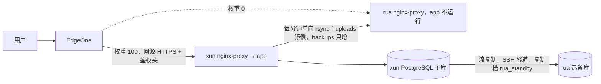

# 双机主备部署（xun / rua）

生产环境的部署与运维手册。两台服务器都在 EdgeOne 之后：xun 对外服务，rua 做热备。本目录的文件就是线上实际使用的版本，服务器上的同名文件从这里复制，改动先改这里再同步。服务器上 `/root/docker/yggdrasil/RUNBOOK.md` 是本文的副本。

## 为什么是主备而不是双活

应用按单写库设计，同时跑两份 app 会出问题：

- 启动时执行迁移，只读的热备库上 `CREATE TABLE IF NOT EXISTS schema_migrations` 会失败，进程直接退出（`src/startup.rs`）。
- 跨实例缓存同步依赖 `LISTEN`，热备库不支持，第二台只能跨机连主库，未命中缓存的请求慢一个数量级。
- 后台任务没有选主：每日备份、清理孤儿素材等会在两台同时运行。
- 上传文件、备份在本地磁盘；代码运行的 SSE 流、备份进度、限流器都在进程内存里，请求落到另一台会 404 或计数翻倍。

所以平时只有 xun 跑 app，rua 只跑热备库；xun 不可恢复时人工把 rua 提升为主。

## 拓扑



| | 平时 | EdgeOne |
|---|---|---|
| xun | `ROLE=primary`：postgres 主库 + app | 源站组中 xun 源站权重 100 |
| rua | `ROLE=standby`：pg-standby 热备，app 不运行（compose 的 `failover` profile） | rua 源站权重 0 |

- **角色文件** `/root/docker/yggdrasil/ROLE`：CI 的 deploy-xun / deploy-rua 先读它。primary 重建 app、健康检查、失败回滚；standby 只预拉 app 与 runner 镜像。deploy-rua 排在 deploy-xun 之后，standby 只在 xun 部署成功后预拉，保证故障切换时启动的版本与 xun 一致。
- **复制**：rua 的 `pg-tunnel.service` 用 SSH 本地转发把 xun 的 `127.0.0.1:5432` 映射到 rua 的 podman 网关 `10.89.0.1:15432`，热备库经它流复制。xun 设 `max_slot_wal_keep_size = 2GB`，rua 长时间断线时复制槽会被作废而不是写满 xun 的磁盘。
- **文件**：xun 的 `ygg-standby-sync.timer` 每分钟推送一次。uploads 镜像同步（`--delete`，排除 `.cache/` 与 rsync 临时文件），backups 只增不删；rua 的 `ygg-backup-prune.timer` 每天删除 30 天前的备份，所以 rua 保留的备份历史比 xun（只留最近 2 份）更长。
- **SSH**：两台之间没有 shell 互信。rua 的 key 在 xun 的 `authorized_keys` 中限定为 `restrict,port-forwarding,permitopen="127.0.0.1:5432",command="/bin/false"`，只能建隧道；xun 的两把同步 key（`id_ygg_sync_uploads`、`id_ygg_sync_backups`）在 rua 上用 `rrsync -wo` 限定为对应目录只写。
- **EdgeOne**：源站组按权重分流，没有健康检查，xun 宕机不会自动切到 rua。回源协议 HTTPS:443，不校验源站证书。
- **源站证书**：两台 nginx-proxy 证书目录里 `rua.plus.crt/.key/.chain.pem` 是 10 年期自签证书（普通文件，不是指向 Let's Encrypt 目录的链接）。compose 不设 `LETSENCRYPT_*`，acme-companion 不管 `rua.plus`。
- **回源鉴权**：两台的 80/443 还承载其它不走 EdgeOne 的站点，不能按 IP 封端口。EdgeOne「修改 HTTP 回源请求头」给 `rua.plus` 加 `X-Ygg-Origin-Auth: <密钥>`，nginx `vhost.d/rua.plus` 中的 `ygg-origin-auth` 块校验，缺失或错误返回 403，`/readyz`、`/healthz` 放行。密钥存在两台的 `/root/.ygg-origin-auth`（权限 600，每行一个，任一匹配即放行）。

## 文件清单

| 本目录 | 安装位置 | 主机 |
|---|---|---|
| `xun/docker-compose.yml` | `/root/docker/yggdrasil/docker-compose.yml` | xun |
| `xun/ygg-standby-sync` | `/usr/local/sbin/ygg-standby-sync` | xun |
| `xun/ygg-standby-sync.{service,timer}` | `/etc/systemd/system/` | xun |
| `rua/docker-compose.yml` | `/root/docker/yggdrasil/docker-compose.yml` | rua |
| `rua/pg-tunnel.service` | `/etc/systemd/system/` | rua |
| `rua/ygg-failover`、`rua/ygg-rebuild-standby` | `/usr/local/sbin/` | rua |
| `rua/ygg-backup-prune.{service,timer}` | `/etc/systemd/system/` | rua |
| `ygg-origin-auth` | `/usr/local/sbin/ygg-origin-auth` | 两台 |

本目录不包含的配置：

- 两台 `/root/docker/yggdrasil/.env`：`POSTGRES_USER/PASSWORD/DB`、`VIRTUAL_HOST`、`VIRTUAL_PORT`、`MCP_TOKEN_ENC_KEY`、`KITE_PLAYER_*`。rua 处于 primary 时额外有 `COMPOSE_PROFILES=failover`。
- rua `/root/.ssh/config` 的 `Host xun-pg`（xun 的 SSH 地址、端口与 `~/.ssh/id_ed25519`），供 `pg-tunnel.service` 使用。
- xun 主库 `pg_hba.conf` 的 `host replication replicator all scram-sha-256` 与 `replicator` 角色；rua 热备库数据目录中的 `standby.signal` 与 `primary_conninfo`（由 `pg_basebackup -R` 写入）。
- `/usr/local/bin/rrsync`：从 `/usr/share/doc/rsync/support/rrsync` 安装。

## 日常检查

```sh
# xun：复制是否在流
podman exec yggdrasil-postgres sh -c 'psql -U "$POSTGRES_USER" -d postgres -c "select application_name,state,replay_lag from pg_stat_replication" -c "select slot_name,active,wal_status from pg_replication_slots"'
# rua：热备状态
podman exec yggdrasil-pgstandby sh -c 'psql -U "$POSTGRES_USER" -d postgres -c "select pg_is_in_recovery(), now()-pg_last_xact_replay_timestamp() as lag" -c "select status from pg_stat_wal_receiver"'
# xun：同步日志
journalctl -u ygg-standby-sync.service -n 20
```

没有写入时 `lag` 会一直增长，属正常；`status` 必须是 `streaming`。xun 上 `wal_status = lost` 表示复制槽已作废，按「只重建热备」处理。

## 故障切换（xun → rua）

1. 判断：xun 整机或主库不可恢复，不是 app 短暂重启。
2. xun 还能登录时，先停掉它并改角色，防止恢复后继续写旧库：`docker stop yggdrasil-app yggdrasil-postgres && echo standby > /root/docker/yggdrasil/ROLE`。
3. rua 上执行 `ygg-failover`：探测到 xun 主库仍可写时拒绝执行；xun 不可达时直接执行；确认 xun 已不再接收流量后可加 `--force`。脚本依次停 `pg-tunnel`、`pg_promote`、清理 rsync 临时文件、在 `.env` 写入 `COMPOSE_PROFILES=failover`、`ROLE=primary`、启动 app 并等待 `/readyz`。
4. EdgeOne 源站组：rua 源站权重改 100，xun 源站改 0。
5. 记录切换时间。复制是异步的，切换前最后几秒的写入可能丢失。

## 回切（rua → xun），在计划维护窗口内进行

xun 的旧库已与 rua 分叉，不能直接启动。数据只有几十 MB，用导出/导入重建 xun 主库，再从 xun 重建 rua 热备。

1. **xun 保持停机**：确认 `yggdrasil-app`、`yggdrasil-postgres` 都已停止，`ROLE=standby`。
2. **rua 停写**：`podman stop yggdrasil-app`，维护开始。
3. **导出**（两台之间没有 shell 互信，从工作站中转）：
   ```sh
   ssh rua 'podman exec yggdrasil-pgstandby sh -c "pg_dumpall -U \$POSTGRES_USER --globals-only"' > globals.sql
   ssh rua 'podman exec yggdrasil-pgstandby sh -c "pg_dump -U \$POSTGRES_USER -Fc \$POSTGRES_DB"' > ygg.dump
   ssh rua 'tar -C /var/lib/containers/storage/volumes/yggdrasil_uploads_data/_data -cf - --exclude=.cache .' > uploads.tar
   ```
4. **xun 重建主库**：
   ```sh
   V=/var/lib/containers/storage/volumes/yggdrasil_postgres_data/_data
   mv $V $V.split-$(date +%Y%m%d) && install -d -m 700 -o 70 -g 70 $V
   cd /root/docker/yggdrasil && docker compose --env-file .env up -d postgres   # 重新 initdb
   ```
   从工作站导入：
   ```sh
   ssh xun 'podman exec -i yggdrasil-postgres sh -c "psql -U \$POSTGRES_USER -d postgres"' < globals.sql   # 已存在角色的报错可忽略
   ssh xun 'podman exec -i yggdrasil-postgres sh -c "pg_restore -U \$POSTGRES_USER -d \$POSTGRES_DB --clean --if-exists --no-owner --role=\$POSTGRES_USER"' < ygg.dump
   ssh xun 'tar -C /var/lib/containers/storage/volumes/yggdrasil_uploads_data/_data -xf - --numeric-owner' < uploads.tar
   ```
   在 xun 上恢复复制配置（新 initdb 的 `pg_hba.conf` 不含复制条目）：
   ```sh
   podman exec -it yggdrasil-postgres sh
   echo 'host replication replicator all scram-sha-256' >> "$PGDATA/pg_hba.conf"
   psql -U "$POSTGRES_USER" -d postgres -c "alter system set max_slot_wal_keep_size = '2GB'" -c 'select pg_reload_conf()'
   ```
5. **xun 启动 app**：`echo primary > ROLE && docker compose --env-file .env up -d --no-deps app`，`/readyz` 返回 200 后在 EdgeOne 把权重改回 xun 100、rua 0。
6. **rua 重建热备**：`ygg-rebuild-standby --yes`（删除 app 容器、`ROLE=standby`、去掉 `COMPOSE_PROFILES`、`pg_basebackup` 建槽并开始流复制）。
7. 确认 xun 的 `ygg-standby-sync.timer` 恢复推送；旧数据目录（xun `*.split-*`、rua `*.old-*`）核对后删除。

## 只重建热备

热备损坏或复制槽已作废时，在 rua 执行 `ygg-rebuild-standby --yes`，不影响 xun 对外服务。复制账号密码取自旧数据目录的 `primary_conninfo`，旧目录不可用时用环境变量 `REPL_PASSWORD` 提供。

## 轮换回源密钥

只在密钥泄露时需要。两台在过渡期同时接受新旧密钥，全程不中断：

1. 生成新密钥：`openssl rand -hex 24`。
2. 两台都把新密钥**追加**到 `/root/.ygg-origin-auth`（保留旧行），执行 `ygg-origin-auth enforce`。
3. EdgeOne「修改 HTTP 回源请求头」把 `X-Ygg-Origin-Auth` 的值改成新密钥，等配置下发（几分钟）。
4. 两台删掉旧行，再执行一次 `ygg-origin-auth enforce`。

临时停用校验：`ygg-origin-auth off`；只观测不拦截：`ygg-origin-auth observe`，经 EdgeOne 访问时响应头 `X-Ygg-Origin-Auth` 显示 `ok` 或 `missing`。

验证直连会被拦截时，要从另一台服务器 `curl --resolve rua.plus:443:<源站 IP>` 测：本地网络若有透明代理，直连源站 IP 可能被转回 EdgeOne，看到的是 EdgeOne 的证书和响应。
